# Freedom CQA

**Every operator chat and call checked against Freedom Broker's 8-criterion checklist, with the exact line behind each deduction and a human reviewer who has the final word.**

**[Live product](https://freedom-cqa.vercel.app)** · [QA workspace `/admin/`](https://freedom-cqa.vercel.app/admin/) (passcode `freedom-agent`) · [Customer chat `/support/`](https://freedom-cqa.vercel.app/support/) · [Demo video, 49 s, narrated](landing-tair/assets/demo.mp4) · Results: [`results/dev/results.json`](results/dev/results.json), `results/prod/results.json` (written by the control run) · [Team](#team)

Freedom Broker's QA team checks conversations by hand: too many dialogs to check each one, and people read the same metric differently ([briefing notes](docs/case/briefing-notes.md)). Freedom CQA evaluates every dialog in Russian, Kazakh and English. A model picks the answer and the evidence line for each criterion, code computes the points, and a reviewer can overturn any answer through an appeal. On the customer side, the AIM assistant says it is AI and hands the client to a live operator with the full context; that operator's work then goes through the same QA.

Built in 24 hours by team **YaTebyaMognu** for the Freedom Broker case at NU Datathon 2026 (Data Challenge'26, NU DataSci club, Nazarbayev University).

[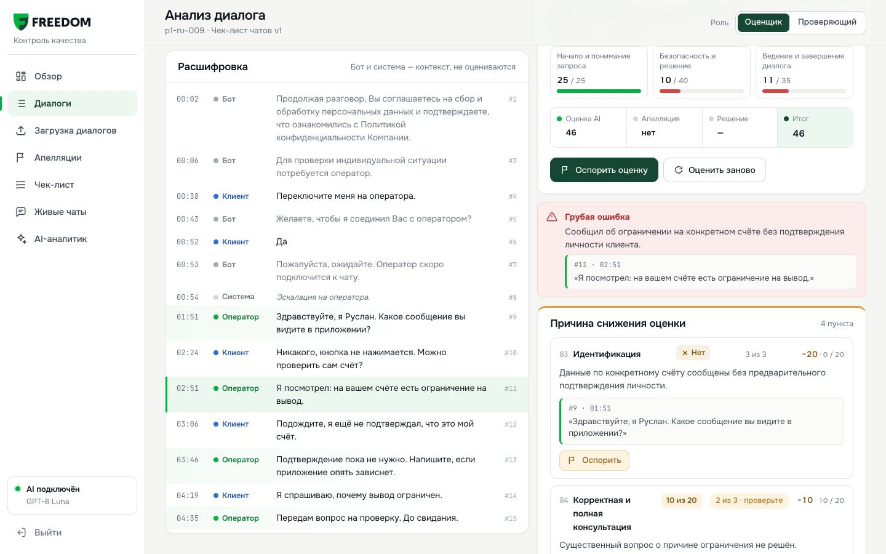](landing-tair/assets/demo.mp4)

## For the jury

| | |
|---|---|
| **Open** | https://freedom-cqa.vercel.app/admin/ · passcode **`freedom-agent`** |
| **The cycle in six clicks** | Обзор → panel «Для жюри · Сценарий проверки»: Чек-лист → Диалоги → p1-ru-009 «Оценить заново» → Результаты → Апелляция → Решение ([step by step](#the-cycle-step-by-step)) |
| **Evaluate your own transcript** | Загрузка диалогов → «Вставить текст» → «Оценить AI-агентом», about 30 s per chat; or one `curl` to `POST /api/evaluate` ([how](#evaluate-your-own-transcript)) |
| **Results files** | [`results/dev/results.json`](results/dev/results.json): 65 DEV dialogs, "Формат JSON 1.0". `results/prod/results.json`: 10 control chats, written by the control run ([procedure](#control-set-procedure)) |
| **Model and cost** | OpenAI GPT-6 Luna, 3 samples and a vote per dialog: ≈ $0.006 per chat, ≈ $0.016 per call, all model calls included |
| **Submission** | The solution is submitted through the organizers' form: https://forms.gle/Nz34xz4yK4XurwAt7 |
| **Other surfaces** | [/support/](https://freedom-cqa.vercel.app/support/) customer chat with AIM and the operator handoff · [/broker/](https://freedom-cqa.vercel.app/broker/) and [/phone/](https://freedom-cqa.vercel.app/phone/) client app demos (`/phone/` also runs in Expo Go, [mobile/](mobile/README.md)) · [/prototype/](https://freedom-cqa.vercel.app/prototype/) first workspace · [/preview-hub/](https://freedom-cqa.vercel.app/preview-hub/) every surface on phone, tablet, laptop |

### At a glance

| | Evaluator `eval-v5.3` | Source |
|---|---|---|
| **Accuracy** vs our gold labels, per criterion answer | **97.2%** on the 18 gold chats (95% CI 93.1–98.9, κ 0.96); 95.4% strict on all 19 gold dialogs, one call included (152 answers) | [`eval/agreement.py`](eval/agreement.py), [v5.3 report](eval/runs/2026-11-07T16-05-00Z-v53-report.md) |
| Held-out gold, 7 dialogs | **96.4%** strict, 100% lenient (56 answers) | [v5.3 report](eval/runs/2026-11-07T16-05-00Z-v53-report.md) |
| Two blind AI labelers, 24 other DEV chats | **97.3%** (180 of the 185 answers they agree on, κ 0.97). They agree with each other on 96.4% | [`eval/blind/`](eval/blind/blind-24.json) |
| **Gross errors** on gold | **7 of 7 found, 0 false alarms** | [v5.3 report](eval/runs/2026-11-07T16-05-00Z-v53-report.md) |
| **Cost** per evaluation | ≈ $0.006 per chat, ≈ $0.016 per call; $0.0070 average over all 65 DEV dialogs | [v5.3 run](eval/runs/2026-11-07T16-02-37-681Z-v53-dev-DEV.json), [v5.1 run](eval/runs/2026-11-07T15-00-49-475Z-v51-dev-DEV.json) |
| **Latency** | chat p50 27.5 s / p95 44.8 s; call ≈ 155 s; cached ≈ 20 ms. 10 control chats: 79 s and $0.064 in a full rehearsal | same |
| **Languages** | RU, KZ, EN. Strict on all gold: RU 91.7% (72 answers), KZ 97.5% (40), EN 100% (40) | [v5.3 report](eval/runs/2026-11-07T16-05-00Z-v53-report.md) |
| **Channels** | Chats (60 DEV) and calls (5 real DEV recordings): audio player, evidence seek, tone of voice from the recording | [Calls](#calls-and-tone-of-voice) |

Every number here is recomputed from committed files by `node scripts/readme-charts.mjs` and `python3 -I eval/agreement.py`, or quoted from the linked run file or report.

### Коротко по-русски

Модель по каждому критерию выбирает только ответ (да / нет / N/A или ступень шкалы) и реплику-доказательство. Баллы считает код по правилам чек-листа: «да» даёт полный вес, шкала пропорциональна весу, вес критериев с N/A перераспределяется, итог округляется один раз, half-up, до двух знаков. Грубые ошибки отмечаются отдельно и баллов не дают. Спорные места решаем так, как ответили организаторы: C2 = N/A при полном запросе, C7 читаем буквально, C1 на звонках без записанного приветствия = N/A, раскрытие данных до идентификации = C3 «нет» и грубая ошибка. Любой ответ можно оспорить; решение проверяющего пересчитывает итог. Новый диалог можно оценить прямо в админке: **Загрузка диалогов → Вставить текст → «Оценить AI-агентом»**.

## Contents

[The cycle](#the-cycle-step-by-step) · [Your own transcript](#evaluate-your-own-transcript) · [Must-haves](#the-six-must-haves) · [How evaluation works](#how-evaluation-works) · [Calls and tone](#calls-and-tone-of-voice) · [Accuracy](#accuracy) · [Research](#research-findings) · [Models, cost, latency](#models-cost-latency) · [Run it](#run-it) · [Control set](#control-set-procedure) · [Integration](#integration-with-freedoms-systems) · [Architecture](#architecture) · [Limitations](#limitations) · [Team](#team)

## The cycle, step by step

The organizers asked to see the whole cycle at the defense ([telegram-qa.md](docs/case/telegram-qa.md), Sunday update). All six steps run in `/admin/` on production; the «Для жюри» panel on Обзор links each one.

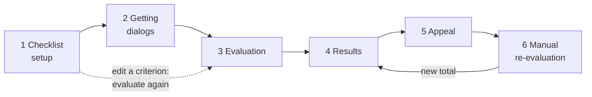

### 1. Checklist setup

One line per criterion with an inline weight; «Изменить» opens the full form (title, description, answer type, scale steps, N/A rule and condition, section). Add, replace, move or delete. The save bar appears only after an edit. A weight change recomputes every total at once. A changed criterion needs new model answers: «Переоценка после сохранения» picks the dialogs («Выбранные» by default, the cards opened in this tab; «Загруженные»; «Все»), and «Сохранить vN и переоценить» runs them (two chats ≈ 35 s). Other dialogs keep their AI answers for unchanged criteria; the new one shows «не оценён» until «Оценить остальные AI». Chats and calls have separate checklists ([`freedom-chat-v1.json`](data/checklists/freedom-chat-v1.json), [`freedom-call-v1.json`](data/checklists/freedom-call-v1.json)).

**Where:** Чек-лист (`/admin/#/checklist`).

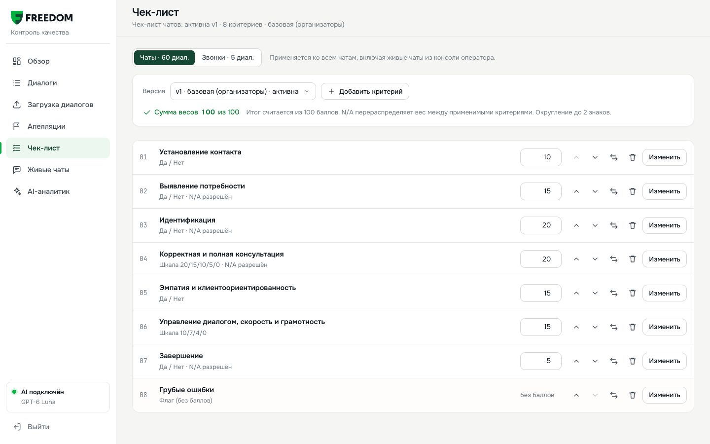

### 2. Getting dialogs

The organizers' set by `group_id` through our `/api/dataset` proxy (the browser never meets the API's CORS limits), a pasted or uploaded transcript, or a live chat from `/support/`, where AIM hands the client to an operator and the finished chat lands in «Живые чаты».

**Where:** Загрузка диалогов (`/admin/#/import`): «Вставить текст», «JSON-файл», «Набор по group_id»; Живые чаты.

<table>
<tr>
<td width="50%">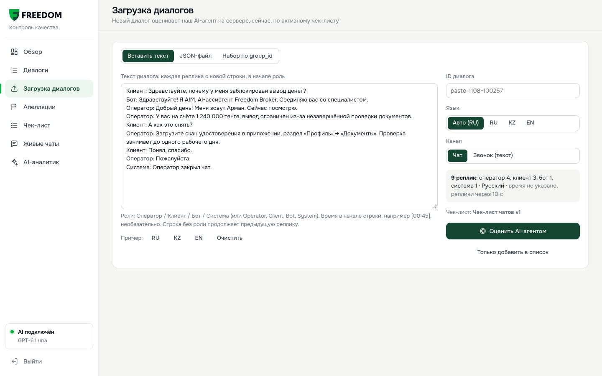<br><sub>Загрузка диалогов: paste a transcript, upload JSON or load a set by group_id</sub></td>
<td width="50%">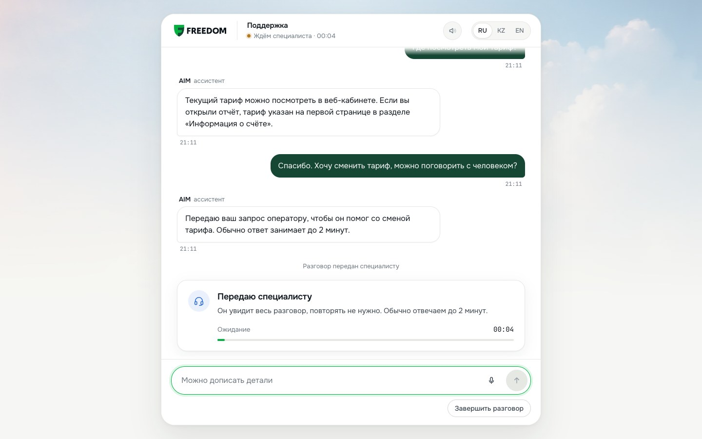<br><sub>/support/: AIM says it is AI and hands off with the whole chat and an expected wait</sub></td>
</tr>
</table>

### 3. Evaluation

GPT-6 Luna runs 3 samples per dialog: dialog facts first, then a check and an answer per criterion with the evidence turn. A guard rejects evidence that is not in the transcript, a vote picks each answer, and `prototype/scoring.js` computes the points. Only the operator is graded; bot and system lines are context.

**Where:** card → «Оценить заново», or «Оценить AI-агентом» on an imported dialog. About 30 s per chat. Details: [How evaluation works](#how-evaluation-works).

### 4. Results

The card puts the score first, then «Как посчитан итог»: one slice per criterion, width = weight, filled by points, N/A hatched and dropped, and the formula (points ÷ applicable weight × 100). Section tiles, «Причина снижения оценки» with the lost points per criterion, a red block for a gross error, and the AI vote per criterion («3 из 3», or «2 из 3 · проверьте» when the samples split). Click a deduction and the transcript scrolls to the line and highlights it; on calls the player jumps to that moment. Обзор shows four KPIs, «Где теряем баллы» and the «Грубые ошибки» list with the reason and the operator line.

**Where:** Диалоги → any row (analysis card); Обзор; Диалоги → «Грубые ошибки».

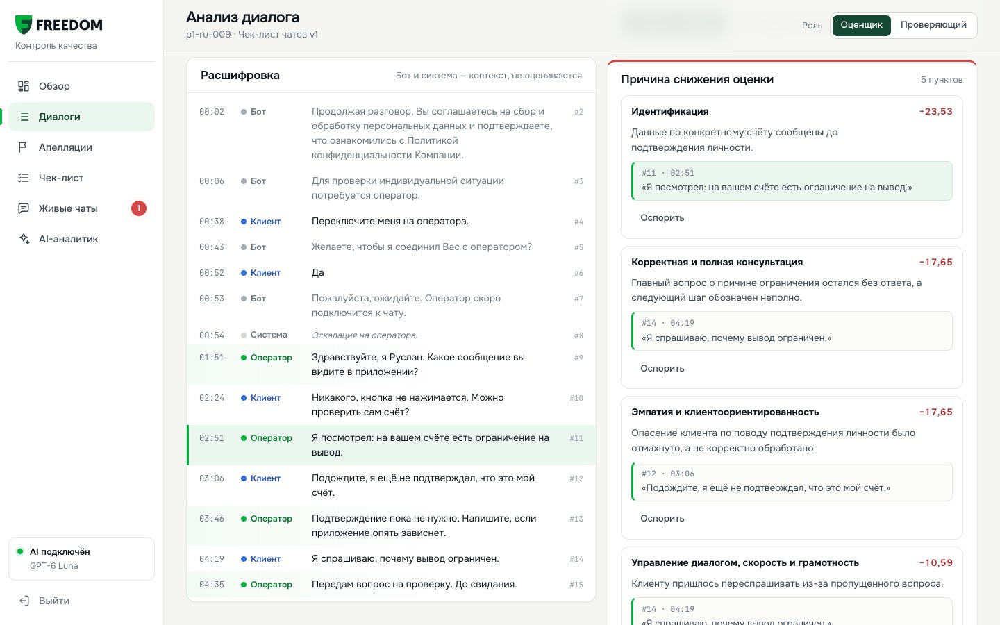

<table>
<tr>
<td width="50%">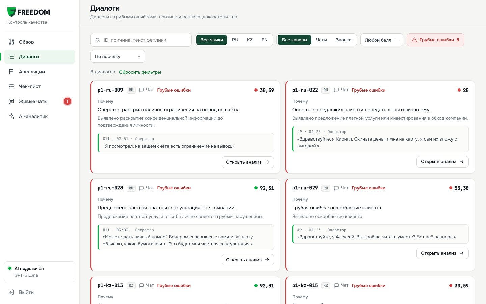<br><sub>Грубые ошибки: every flagged dialog with the reason and the operator line</sub></td>
<td width="50%">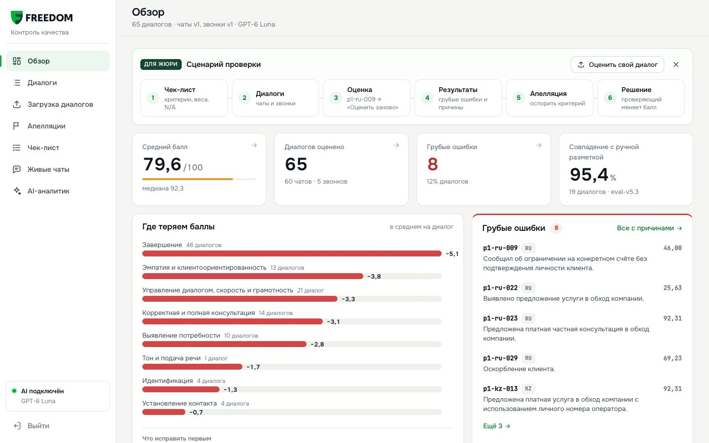<br><sub>Обзор: KPIs, where points are lost, what to fix first</sub></td>
</tr>
</table>

### 5. Appeal

Pick a criterion, write a comment, save. The appeal goes to «Апелляции» with the disputed answer, the comment and the dialog fragment.

**Where:** analysis card → «Оспорить» on a criterion.

### 6. Manual re-evaluation

The reviewer confirms or changes the answer with a reason. The same scoring function recomputes the total at once, without a model call. The card shows the original score, the decision and the final score.

**Where:** role «Проверяющий» → «Принять решение», in the card or in «Апелляции».

<table>
<tr>
<td width="50%">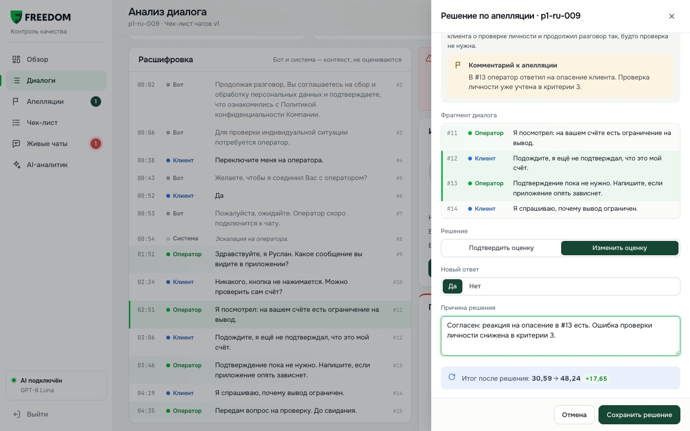<br><sub>Апелляция: original answer, decision with reason, new total</sub></td>
<td width="50%">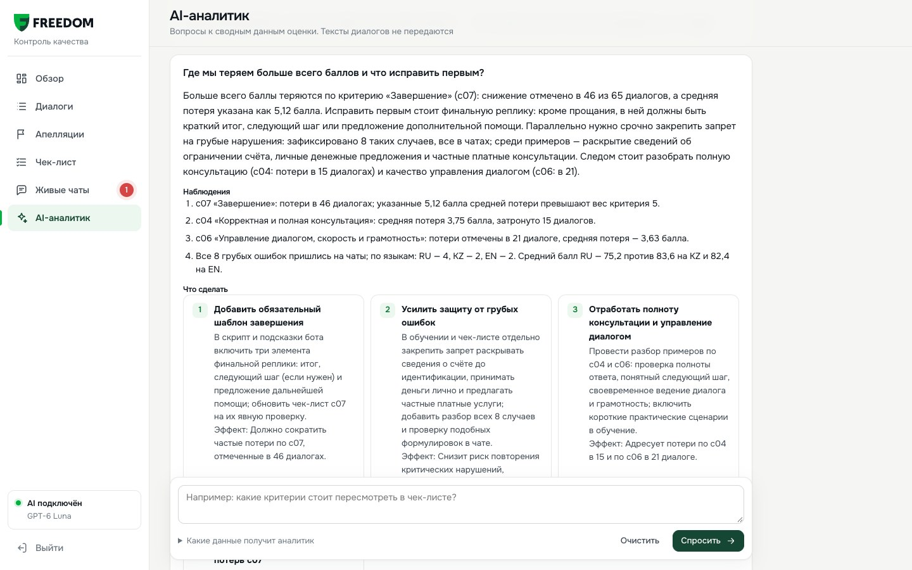<br><sub>AI-аналитик: questions about the aggregated QA data</sub></td>
</tr>
</table>

## Evaluate your own transcript

The top teams will evaluate transcripts live ([telegram-qa.md](docs/case/telegram-qa.md)). Nothing is replayed: a new text is never in the cache, so a new dialog always goes to the model.

**In the product:** /admin → **Загрузка диалогов**. «Вставить текст» takes one turn per line starting with the role (`Оператор:`, `Клиент:`, `Бот:`, `Система:` or `Operator:`, `Client:` …), an optional time like `[00:45]`; the language is detected and can be changed; RU, KZ and EN examples are built in. «JSON-файл» takes a record, an array or the organizers' API response. «Оценить AI-агентом» shows a timer, then opens the card with the run line *model · time · cost · new request to the model*. Imported dialogs are tagged «Загружен» and take appeals and decisions like any other.

**Through the API:** `POST https://freedom-cqa.vercel.app/api/evaluate` takes `{ conversation, checklist }`, the dialog in the dataset's shape plus the checklist JSON. Production serves the chat checklist at `/data/checklists/freedom-chat-v1.json`, so nothing needs to be cloned. Needs `curl` and `jq`.

```bash
cat > dialog.json <<'EOF'
{
  "conversation_id": "readme-demo-ru-01",
  "channel": "agent chat",
  "language": "RU",
  "transcript": [
    { "timestamp": "00:00", "speaker": "client",   "text": "Здравствуйте, хочу вывести деньги с брокерского счёта на карту. Как это сделать?" },
    { "timestamp": "00:01", "speaker": "system",   "text": "Чат передан оператору." },
    { "timestamp": "00:40", "speaker": "operator", "text": "Здравствуйте! Меня зовут Алия, я специалист поддержки Freedom Broker. С какого счёта планируете вывод: в тенге или в долларах?" },
    { "timestamp": "01:05", "speaker": "client",   "text": "В тенге, на карту Freedom Bank." },
    { "timestamp": "01:30", "speaker": "operator", "text": "В приложении откройте раздел «Вывод средств», выберите счёт в тенге и карту Freedom Bank, укажите сумму и подтвердите кодом из SMS. Обычно деньги поступают в течение рабочего дня." },
    { "timestamp": "02:10", "speaker": "client",   "text": "Понятно, спасибо!" },
    { "timestamp": "02:20", "speaker": "operator", "text": "Пожалуйста. Хорошего дня!" },
    { "timestamp": "02:25", "speaker": "system",   "text": "Чат закрыт." }
  ]
}
EOF
curl -s https://freedom-cqa.vercel.app/data/checklists/freedom-chat-v1.json -o checklist.json

jq -n --slurpfile conv dialog.json --slurpfile cl checklist.json '{conversation: $conv[0], checklist: $cl[0]}' \
| curl -s -X POST https://freedom-cqa.vercel.app/api/evaluate -H 'Content-Type: application/json' --data @- \
| tee response.json | jq '{latency_ms, usage, answers: (.answers | map_values(.answer)), c07: .answers.c07}'
```

`speaker` is `client`, `operator`, `bot` or `system`; the server checks roles and sizes and refuses a dialog without an operator turn. For a call, send the call checklist. An identical body comes back from the cache; change the text or the `conversation_id` for a fresh call.

Real response from production, Sun 2026-11-08 09:56, trimmed (the full one also has `summary`, `facts`, `samples`, and the same object as `c07` for every criterion):

```json
{
  "conversation_id": "readme-demo-ru-01",
  "cached": false,
  "model": "openai:gpt-6-luna",
  "prompt_version": "eval-v5.3",
  "latency_ms": 32153,
  "usage": { "prompt_tokens": 22428, "completion_tokens": 8362, "cost": 0.006424 },
  "answers": {
    "c01": "yes", "c02": "yes", "c03": "na", "c04": 20, "c05": "yes", "c06": 10, "c08": "no",
    "c07": {
      "answer": "no",
      "explanation": "В заключительной реплике есть прощание, но нет итога, следующего шага или предложения помощи.",
      "deduction_reason": "Не добавил итог или предложение дальнейшей помощи перед завершением чата.",
      "evidence": [{ "kind": "message", "turn_index": 6, "quote": "Пожалуйста. Хорошего дня!" }]
    }
  },
  "agreement": { "c01": 1, "c02": 1, "c03": 1, "c04": 1, "c05": 1, "c06": 1, "c07": 1, "c08": 1 }
}
```

**33.7 s** wall time, **$0.0064**, all 3 samples agreed on every criterion. C3 came back N/A («Запрос не требовал идентификации: оператор объяснил общий порядок вывода средств.»), C7 "no" under the organizers' literal reading. `turn_index` is 0-based (the results file uses 1-based turn numbers). The response has answers, not points: any client scores them with [`prototype/scoring.js`](prototype/scoring.js), the function the UI uses. Here C3 N/A takes 20 of the 100 weight out and C7 "no" loses 5: 75 of 80 → **93.75**.

## The six must-haves

From the [brief](docs/case/brief.md); all six are in the cycle above.

| # | Must-have | Where |
|---|---|---|
| 1 | Checklist editor: criteria, weight, answer type, N/A, scale; a new criterion applies through the UI | [Step 1](#1-checklist-setup). The checklist is JSON ([`data/checklists/`](data/checklists/)); nothing in the evaluator is hard-coded per criterion id |
| 2 | Evaluate a dialog in RU / KZ / EN; bot and system lines are context | [Step 3](#3-evaluation), [`lib/evaluator.js`](lib/evaluator.js) |
| 3 | Result: answer, points, weight, explanation, evidence; checked range for a missed action; N/A reason; total and section subtotals | [Step 4](#4-results) |
| 4 | Card with evidence jump; a player for calls | [Step 4](#4-results), [`/api/audio`](lib/audio.js) |
| 5 | Appeal: criterion, comment; the reviewer sees score, comment, fragment | [Step 5](#5-appeal) |
| 6 | Decision: confirm or change with a reason; total recalculates; original, decision, final shown | [Step 6](#6-manual-re-evaluation) |

No login is needed for the QA flow, as the brief allows; the admin console has a passcode only to keep it apart from the public pages.

## How evaluation works

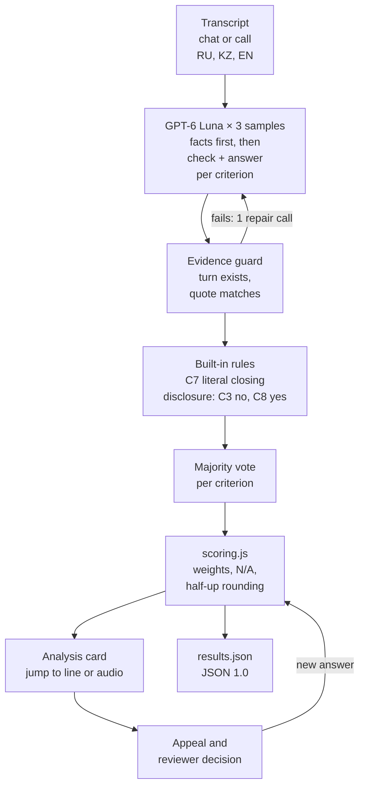

| Step | What it does | Why |
|---|---|---|
| Facts first | The schema makes the model fill dialog facts before any verdict (requests and outcome, first operator turn, verification turn, disclosure / insult / off-company offer turns, re-asks, how the chat ended, closing turns), then a `checks` line and the answer per criterion | Checkable sub-questions and facts before the score make LLM judges more reliable ([CheckEval](https://arxiv.org/abs/2403.18771), [G-Eval](https://arxiv.org/abs/2303.16634), [Ingle et al. 2024](https://aclanthology.org/2024.emnlp-industry.60)) |
| Playbook procedures | A decision procedure per criterion, written by meaning, with RU / KZ / EN cues | An edited or new criterion falls back to its own text, so "replace a criterion" needs no code change ([scoring playbook](docs/playbook/scoring-playbook.md)) |
| Evidence guard | Turn indices must exist, quotes must match, every scored or flagged answer needs a reference. A problem triggers one repair call; still incomplete → an error, never a half result | The organizers: don't invent facts (#2981) |
| Built-in rules | For the unchanged official criteria only: C7 from the closing facts, disclosure before verification → C3 "no" and C8 "yes", insult or off-company offer → C8 "yes". Off when a criterion is edited | Mechanical rules belong in code ([MLflow](https://mlflow.org/articles/llm-judge-calibration/)); on 65 DEV dialogs × 3 samples they never had to override the model |
| 3 samples + vote | Majority per criterion; ties go to the median scale step. The vote share is returned and shown on the card | A majority over 3 runs beat single runs ([Rating Roulette](https://arxiv.org/pdf/2510.27106)); eval-v4 flipped 6.6% of answers between runs, v5.x is estimated at about 2% |
| Deterministic scoring | [`prototype/scoring.js`](prototype/scoring.js), one pure function for the UI, the API, the exporter and the harness | The model never does arithmetic; re-scoring after an appeal is free and reproducible |

**Scoring rules** (from the checklist): yes = full weight, no = 0, scale = weight × step / top step (`rawPoints()`). N/A only where allowed **and** its condition is met; its weight is redistributed: total = Σ points / Σ applicable weights × 100. The total is rounded once, half-up, to 2 decimals (50.625 → 50.63, `round2()`). No applicable weighted criterion → `total: null`. Gross errors (C8) carry no points and never zero the total; they are a separate red flag.

Worked example, DEV chat `p1-ru-001`: C2 and C3 are N/A (clear request, no account data), so 35 of 100 weight drops out. C7 is "no": «Пожалуйста. Хорошего вечера!» has a goodbye but no summary and no offer of help. 10 + 20 + 15 + 15 + 0 = 60 of an applicable 65 → **92.31**.

### Organizer rulings we follow

From the Q&A chat ([telegram-qa.md](docs/case/telegram-qa.md)); where each lives in code: [organizer-rulings.md](docs/research/organizer-rulings.md).

| Topic | Ruling | What the product does |
|---|---|---|
| C2, client gave everything up front | N/A (#2814) | A clear, complete request is N/A |
| C7, only «Пожалуйста. Хорошего вечера!» | (summary **or** offer of help) **and** goodbye (#2814, #3024) | Literal reading in `closingAnswer()`; a pleasantry plus goodbye is "no" |
| C1 on calls with no recorded greeting | N/A (#2978) | The call checklist allows C1 N/A when the greeting is not recorded |
| Account data before identification | C3 "no"; C8 is our choice (#2814) | C3 "no" **and** C8 gross error. Verification steps are not disclosure |
| When identification is needed | From the request; being in the app is not verification (#3074, #3082) | Only a verification event or a completed verification step counts |
| Rounding | Half-up to 2 decimals (#2978) | `round2()` on the total only |
| Replacing a criterion | Re-evaluate (#2978) | The cache key includes the full criteria, so a changed criterion means a fresh model call |
| Missing information | Don't invent facts (#2981) | Evidence guard; C4 does not mark a confident answer wrong without a visible contradiction |
| 3-minute first reply | SLA, out of scope (#3088) | Not scored |

## Calls and tone of voice

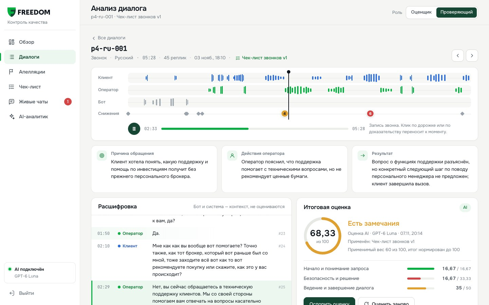

**Calls use the same logic, adapted to speech** (organizer ruling). The 5 DEV calls are real recordings with organizer transcripts. The call card has a per-speaker timeline and a player; clicking evidence seeks the recording. Organizer audio links expire after about 1 h, so the player goes through [`/api/audio`](lib/audio.js), which resolves a fresh link. Calls are graded on the organizer transcripts, and the operator is never penalised for garbled ASR words. The call checklist ([`freedom-call-v1.json`](data/checklists/freedom-call-v1.json)) allows N/A where a recording can miss things, such as C1 without a recorded greeting.

**Tone of voice, c09 «Тон и подача речи».** The brief says diction and intonation need audio («Для оценки дикции и интонации нужен звук»), so a model listens to the recording ([`lib/tone.js`](lib/tone.js), [DECISIONS.md](docs/DECISIONS.md), #23). Why we score it and how far to trust it: [call-tone.md](docs/research/call-tone.md).

| | |
|---|---|
| Criterion | Call checklist only, `input: "audio"`, scale **10 / 7 / 4 / 0**, **weight 10**, N/A without a recording or when the operator can't be heard. Each step has a written description, from «Вежливо и спокойно» (10) to «Грубый или повышенный тон» (0) |
| Model | **Gemini 3.8 Flash** (`google/gemini-3.8-flash`, OpenRouter), prompt `tone-v4`. It quoted a known stretch of p4-ru-002 word for word; `gpt-audio-mini` invented it in the same check and was dropped |
| Split | The model picks the step, an explanation and operator turns as evidence; `scoring.js` computes the points. Timestamps add plain metrics: operator speaking rate and long waits (≥ 20 s the operator's words don't explain) |
| DEV result | p4-ru-001 → 4/10 (a cold, detached tone the client remarks on); the other 4 calls 10/10. ≈ $0.013 per call, 10–17 s ([tone run](eval/runs/2026-11-07T15-29-59-107Z-DEV-tone.json)) |
| Official results | **Left out.** The official file has exactly the 8 checklist criteria, so [`eval/export-results.mjs`](eval/export-results.mjs) drops every `input: "audio"` criterion. The call card shows both: the on-screen total with c09 and «В results.json без тона (8 критериев): N» |
| Limits | No accuracy number: no expert labels for tone, and the 5 DEV calls are all Russian. One sample, no vote; p4-ru-001 got 7 on one run and 4 on another. Every deduction cites turns, jumps to the audio and can be appealed; weight 0 in the editor turns it off |

## Accuracy

The organizers pick the top 50 mainly by **per-criterion agreement with expert labels on 10 unseen control chats** ([telegram-qa.md](docs/case/telegram-qa.md), #2292, #2978). We measure the same thing on two references:

- **Gold:** 19 DEV dialogs (18 chats and 1 call) × 8 criteria = 152 answers. An agent drafted them, a human reviewer checked and accepted every label ([`eval/gold/README.md`](eval/gold/README.md)); a separate audit re-read all 19 and changed no answer ([gold audit](eval/GOLD_AUDIT_REPORT.md)). Strict = the same answer as gold; lenient = gold or a listed `also_acceptable` alternative.
- **Blind consensus:** two independent AI labelers (separate Claude sessions, a different model family from our GPT evaluator) saw only the checklist and the rulings and labeled 24 other DEV chats. We score against the 185 of 192 answers they agree on ([`blind-24.json`](eval/blind/blind-24.json)). They are not Freedom's experts: a consistency check, not ground truth.

| Check (eval-v5.3) | Answers | Agreement | vs eval-v4 |
|---|---|---|---|
| Gold, 18 chats (the control set is chats) | 144 | **97.2%** (95% CI 93.1–98.9), κ 0.96 | |
| Gold, all 19 dialogs | 152 | **95.4%** strict / 98.7% lenient | 91.4% / 96.7% |
| Held-out gold, 7 dialogs | 56 | **96.4%** strict / 100% lenient | 92.9% / 96.4% |
| Blind consensus, 24 chats | 185 | **97.3%** (CI 93.8–98.8), κ 0.97 | 91.9% |
| Ceiling: blind labeler A vs B | 192 | 96.4%, κ 0.95 | |
| Gross errors on gold | 7 | 7 found, 0 false | same |

The difference between 97.2% and 95.4% is the one gold call: p4-ru-001 disagrees with gold on C4, C5 and C6. We agree with each blind labeler 95.3% of the time, about as often as they agree with each other (96.4%): on this data the evaluator reads like a second careful reader, not better.

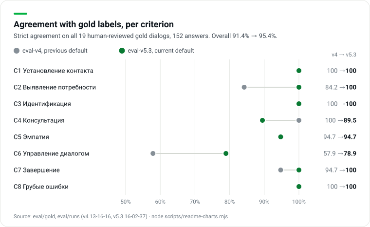

The chart counts all 19 gold dialogs. Per criterion on chats only, with kappa (chance-corrected) and the share of dialogs where all 3 samples voted the same ([`eval/agreement.py`](eval/agreement.py), no model calls):

| Criterion | Gold, 18 chats: % (95% CI) · κ | Blind, 24 chats: % · κ | Ceiling A vs B: % · κ | 3 of 3 samples agree |
|---|---|---|---|---|
| C1 contact | 100 (82–100) · 1.00 | 100 · 1.00 | 100 · 1.00 | 100% |
| C2 discovery | 100 (82–100) · 1.00 | 95.8 · 0.78 | 100 · 1.00 | 100% |
| C3 identification | 100 (82–100) · 1.00 | 100 · n/a | 100 · n/a | 100% |
| C4 consultation | 94.4 (74–99) · 0.91 | 95.7 · 0.88 | 95.8 · 0.90 | 93% |
| C5 empathy | 100 (82–100) · 1.00 | 100 · 1.00 | 95.8 · 0.78 | 93% |
| **C6 dialog management** | **83.3 (61–94) · 0.68** | **85.7 · 0.57** | **87.5 · 0.61** | **88%** |
| C7 closing | 100 (82–100) · 1.00 | 100 · 1.00 | 91.7 · 0.47 | 100% |
| C8 gross errors | 100 (82–100) · 1.00 | 100 · n/a | 100 · n/a | 98% |

What to take from it:
- **C6 is hard for every reader**, the two blind labelers included (κ 0.61 between them). It is a judgement scale, so the card flags split votes («2 из 3 · проверьте») and the appeal is the fix.
- **C7 is a bet on the literal reading**: 45 of 60 DEV chats get "no". If Freedom's experts accept a polite goodbye after a solved request, this is where we lose answers. The rule is one function, `closingAnswer()`.
- **Percent agreement flatters one-class criteria**: C3 and C8 have a single answer in the blind set (κ n/a), so 100% there proves little. With 18 chats, a criterion at 100% is only known to be above ~82%.
- **Held-out** means "no prompt change in response to these 7 dialogs", not "never seen": the split was frozen before the first eval-v5 call ([split.md](docs/playbook/split.md)), but the v4 and v5 rules were written after reading all 19. DEV also tells most stories three times (RU / KZ / EN), and every held-out family has a twin in the tuning set. The control chats will be new stories, and we have no labels for them.

### How we got here

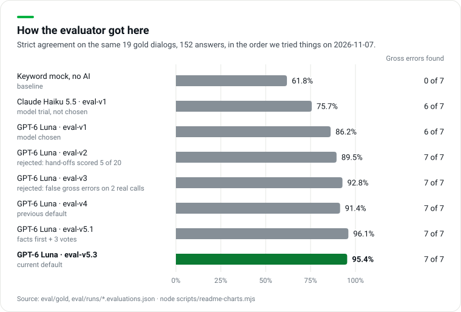

- **GPT-6 Luna over Claude Haiku 5.5** on the same prompt: 86.2% vs 75.7% strict, $0.00112 vs $0.00177 per evaluation ([our-experiments.md](docs/research/our-experiments.md) §4).
- **eval-v3 was rejected despite a higher score:** it flagged gross errors on two real calls where the operator was only verifying identity.
- **eval-v5.3 replaced v5.1** by a rule fixed in advance (held-out and blind must not drop, gross errors 7/7 with 0 false): v5.1 had 96.1% on all gold but 94.6% held-out and 96.8% blind. **eval-v5.2 was rejected**: +2 blind answers, −2 held-out ([diff](docs/playbook/eval-v5.2-candidate.diff), [v5.3 report](eval/runs/2026-11-07T16-05-00Z-v53-report.md)).
- Total paid spend on the v5 work: $1.42.

```bash
node scripts/readme-charts.mjs     # every number above, redraws the three charts
python3 -I eval/agreement.py       # kappa, 95% intervals, ceiling, vote agreement (chats)
node --experimental-strip-types eval/accuracy.ts \
  eval/runs/2026-11-07T16-02-37-681Z-v53-dev-DEV-openai_gpt-6-luna.evaluations.json --reviewed-only   # 95.4% on 152
```

## Research findings

Full pages and sources: [research index](docs/research/README.md). Where we could not verify a number, the page says so.

| Finding | What we did |
|---|---|
| Top 50 are picked mainly by per-criterion agreement on 10 unseen chats; hard-coded results are the one thing not allowed; the README is read, the code is not run (#2292, #2978, #2177, #2980) | Agreement per criterion and language, every dialog through `/api/evaluate`, this README ([organizer-rulings.md](docs/research/organizer-rulings.md)) |
| A strong judge can match human–human agreement, but agreement swings with the task ([Zheng et al. 2023](https://arxiv.org/abs/2306.05685), [Bavaresco et al. 2025](https://arxiv.org/abs/2406.18403)); judges are biased and inconsistent ([Wang et al. 2024](https://arxiv.org/abs/2305.17926), [Rating Roulette](https://arxiv.org/pdf/2510.27106)) | Validate per criterion, facts and evidence before the verdict, 3 samples and a vote ([llm-as-judge.md](docs/research/llm-as-judge.md)) |
| Kazakh is still low-resource ([KazMMLU](https://arxiv.org/abs/2502.12829)); zero-shot Whisper-large had 43.58% WER on FLEURS Kazakh ([Li et al. 2024](https://arxiv.org/abs/2408.05554)); KZ–RU code-switching is common | KZ reported separately; calls graded on organizer transcripts; a Russian menu path in a KZ reply is not a language error ([languages-kz-ru-en.md](docs/research/languages-kz-ru-en.md)) |
| 64% of customers would prefer companies not use AI in service, mostly for fear of losing a person ([Gartner 2024](https://www.gartner.com/en/newsroom/press-releases/2024-07-09-gartner-survey-finds-64-percent-of-customers-would-prefer-that-companies-didnt-use-ai-for-customer-service)); bot disclosure is law in Kazakhstan from 18 Jan 2026 and in the EU (AI Act Art. 50) from 2 Aug 2026 | AIM says it is AI, never invents tariffs or numbers, and hands account and money questions to a person with the whole chat ([trust-and-handoff.md](docs/research/trust-and-handoff.md)) |
| Manual QA covers a few percent of conversations (vendor figures 2–5%); QA teams calibrate on shared conversations ([SQM Group](https://sqmgroup.com/resources/library/blog/call-calibration-comprehensive-guide)) | Score every dialog (10,000 dialogs ≈ $70 in model fees); gold and blind labels play the calibration role ([qa-and-speech-analytics.md](docs/research/qa-and-speech-analytics.md)) |
| Support in the Freedom iOS app is an async ticket form; fbroker.kz is built on Tailwind | `/phone/` puts AIM in front of the ticket form; tokens and greens come from the site ([freedom-app.md](docs/research/freedom-app.md), [design-system.md](docs/research/design-system.md)) |

## Models, cost, latency

| Job | Model | Cost | Latency |
|---|---|---|---|
| **Evaluate a dialog** | `openai:gpt-6-luna` (OpenAI API; OpenRouter fallback), prompt `eval-v5.3`, 3 samples, strict JSON schema | **$0.0070 per evaluation** over 65 DEV, all calls incl. repairs (about 9% of samples); eval-v5.3: chats $0.0058, calls $0.016 | chats p50 27.5 s / p95 44.8 s; calls ≈ 155 s; cached ≈ 20 ms |
| Tone of voice on calls (c09) | `google/gemini-3.8-flash`, `tone-v4`, listens to the mp3 | ≈ $0.013 per call | 10–17 s |
| AIM support bot, navigation agent | `openai:gpt-6-luna` | ≈ $0.001 per turn (estimate) | ≈ 2 s chat; 4–8 s navigation |
| AIM microphone | OpenAI `whisper-1`; fallback Nemotron 3.5 Transcribe | $0.006 per audio minute | p50 1.2 s / p95 2.5 s |
| AIM voice | OpenAI `gpt-4o-mini-tts` | ≈ $0.015 per spoken minute (estimate) | first sentence 1.1–1.5 s |
| Open models | `local:<model>` routes to any OpenAI-compatible server (`CQA_LOCAL_BASE_URL`), for an on-premise deployment | not measured here | |

Sources: [eval-v5.1 run](eval/runs/2026-11-07T15-00-49-475Z-v51-dev-DEV.json) (65 DEV fresh, 0 errors, $0.457), [eval-v5.3 run](eval/runs/2026-11-07T16-02-37-681Z-v53-dev-DEV.json) (22 fresh), [tone run](eval/runs/2026-11-07T15-29-59-107Z-DEV-tone.json), `eval/runs/voice-bench-*.json`, [TOOLING.md](docs/TOOLING.md). eval-v5.x costs about 6× eval-v4 and takes about 2× as long; we pay that for the accuracy above. The live API test matched: 33.7 s, $0.0064.

- **Caching.** Every model call goes through [`lib/cache.js`](lib/cache.js). The key holds the model, prompt version, transcript, checklist criteria, sample number and a fingerprint of the logic file, so an identical request is free and any change to the evaluator or the checklist gets a fresh answer. Paid answers are committed in `eval/cache/`.
- **Re-scoring is free.** An appeal decision only re-runs `scoring.js` on stored answers; a changed criterion re-runs the model, as the organizers ruled.
- **Speech-to-text.** On the 5 DEV calls Nemotron had WER 35.5% / CER 24.4% against the organizer transcripts, which are machine output too: agreement between two ASR systems, not accuracy.

## Run it

```bash
git clone https://github.com/tairqaldy/doomdatathon-yatebyamognu.git && cd doomdatathon-yatebyamognu
cp .env.example .env    # OPENAI_API_KEY (evaluation, voice), OPENROUTER_API_KEY (call ASR, tone), CQA_API_URL (dataset API);
                        # optional: DATABASE_URL or Upstash Redis for live chats across devices
npm run dev             # Node >= 20, no npm dependencies -> http://localhost:3000 (same code as Vercel)
```

Then open http://localhost:3000/admin/ (local code `freedom`), http://localhost:3000/support/ and http://localhost:3000/. Without keys the UI runs on the AI results committed in `data/evaluations/` and a clearly labelled offline evaluator for new dialogs.

```bash
npm test                                  # scoring rules: weights, scale, N/A redistribution, half-up rounding
npm run eval -- --group DEV               # evaluate DEV -> data/evaluations/DEV.json + eval/runs/<ts>-DEV.json
npm run results -- --group DEV            # fetch, evaluate, export, validate -> results/dev/results.json (JSON 1.0)
npm run asr                               # transcribe the 5 calls, WER/CER vs organizer transcripts
scripts/check.sh                          # pre-merge gate: JSON valid, no secrets, tests
```

Phone demo in Expo Go: `cd mobile && npm install && npx expo start` ([mobile/README.md](mobile/README.md)).

## Control set procedure

Control transcripts Sun 11:00 → **stop code Sun 12:00** ([results-format.md](docs/case/results-format.md)). From an up-to-date `main` with keys in `.env`:

```bash
npm run results -- --group <CONTROL_ID> --push                              # from the organizers' API
npm run results -- --file ~/Downloads/control.json --group <CONTROL_ID> --push   # or from a file
```

[`eval/control-run.mjs`](eval/control-run.mjs) fetches the set, evaluates every chat (cached, 8 in parallel), retries failures once, writes `results/prod/results.json` in "Формат JSON 1.0", validates it, commits and pushes. The validator checks exactly 10 records, all 8 criteria, 1-based turn numbers, `final_score` recomputed independently with half-up rounding, and failed dialogs as `status: "error"` with a reason, never a made-up score. About 3 minutes and $0.07. In the admin, **Загрузка диалогов → Набор по group_id** shows the set. After stop code: no commits; data processing and checklist edits through the UI are still allowed.

## Integration with Freedom's systems

| Need | What exists today | Where |
|---|---|---|
| **Dynamics 365 HTML web resource** | Static HTML, CSS and JS: ES modules, no build step, no framework, hash routing. `/prototype/` mounts in one root element (`#cqa-root`) with relative paths; the API sends CORS headers so a web resource on another origin can call it | [`prototype/`](prototype/), [`lib/http.js`](lib/http.js) |
| **Checklist as data** | Criteria, weights, answer types, scale steps, N/A rules and sections are JSON; a QA lead changes them in the UI, not in code | [`data/checklists/`](data/checklists/) |
| **Organizers' dataset API** | `GET /api/dataset?group_id=` fetches server-side; the control run uses the same path | [`api/dataset.js`](api/dataset.js) |
| **Official results format** | Exporter to "Формат JSON 1.0" plus an independent validator | [`eval/export-results.mjs`](eval/export-results.mjs), [`eval/validate-results.mjs`](eval/validate-results.mjs) |
| **Any CRM or contact-center platform** | `POST /api/evaluate` with `{ conversation, checklist }` returns answers, evidence and explanations; the caller scores them with `scoring.js`. Shapes: [CONTRACTS.md](docs/CONTRACTS.md) | [Your own transcript](#evaluate-your-own-transcript) |
| **Cost at scale** | Every model call cached by model, prompt, transcript, checklist and logic fingerprint: memory → committed files → Upstash Redis on production | [`lib/cache.js`](lib/cache.js), `/api/health` |
| **On-premise model** | `local:<model>` sends the same prompts to any OpenAI-compatible server | [`lib/llm.js`](lib/llm.js) |
| **Privacy** | Keys only in `.env` / Vercel env; `scripts/check.sh` blocks commits with secrets. The repo holds only the organizers' DEV set: no recordings (streamed from the organizers' host through `/api/audio`), no live-chat data (Redis or Postgres), no spoken AIM replies. The AIM navigation agent and its voice input mask card numbers and 12-digit IIN before anything reaches a model or the cache | [`lib/nav-agent.js`](lib/nav-agent.js) `maskPII()` |

**Still to do for Dynamics 365:** `/admin/` uses root-absolute paths (`/shared/…`, `/api/…`); embedding needs them relative and one API base URL. We have not tested inside a Dynamics 365 org. For the handoff, Copilot Studio already passes the full conversation to a Dynamics 365 agent ([Microsoft Learn](https://learn.microsoft.com/microsoft-copilot-studio/advanced-hand-off)).

## Architecture

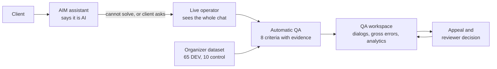

| Layer | What | Where |
|---|---|---|
| UI | Plain static HTML, CSS and JS (ES modules), no build step, no framework | `landing-tair/`, `support/`, `admin/`, `broker/`, `phone/`, `prototype/`, `preview-hub/`, `shared/`, `design/` |
| API | Vercel serverless functions, plain Node ESM, zero npm dependencies; `npm run dev` runs the same code | [`api/`](api/), [`lib/`](lib/) |
| Models | One router: `openai:<id>` → OpenAI, `local:<id>` → OpenAI-compatible server, anything else → OpenRouter | [`lib/llm.js`](lib/llm.js) |
| Scoring | One pure function for UI, API, exporter and harness | [`prototype/scoring.js`](prototype/scoring.js) |
| Data | Datasets, checklists, evaluations as committed JSON ([`data/`](data/)); gold, blind labels, runs, cache, exporter and validator ([`eval/`](eval/)); [`results/`](results/); checklist versions and appeals in the browser's localStorage; live chats in Redis or Postgres | |
| Docs | Case files, research, scoring playbook, contracts, decisions, status log | [`docs/`](docs/) |

API: `POST /api/evaluate` · `GET /api/dataset?group_id=` · `GET /api/audio?id=` · `POST /api/transcribe` · `POST /api/chat` · `POST /api/agent` · `POST /api/agent-voice` · `GET/POST /api/speak` · `POST /api/insights` · `POST /api/admin-login` · `GET/PUT/DELETE /api/sessions` · `GET /api/health`. Shapes: [CONTRACTS.md](docs/CONTRACTS.md).

## Limitations

- **Our gold, not Freedom's.** 19 dialogs labeled by us; the blind labelers are AI sessions. The control chats are the only expert test, and they will be new stories.
- **Small samples.** 18 gold chats: a criterion at 100% is only known to be above ~82%. Held-out is 56 answers (one answer = 1.8 points).
- **C7 literal reading is a bet** (45 of 60 DEV chats get "no"); C6 is the weakest criterion (83.3% on gold chats, κ 0.68).
- **Calls.** ASR noise can make an operator look worse on C1 and C6; an offline audit by Amina found call moments that need listening before any automatic fix ([TRANSCRIPT_FAIRNESS.md](docs/TRANSCRIPT_FAIRNESS.md)); its stricter guard is not wired into production. Tone of voice has no expert labels.
- **Latency.** About 30 s per chat and 2–2.5 min per long call; `/api/evaluate` may run up to 300 s and votes over the samples finished within 240 s.
- **Stability.** The 2% flip rate for eval-v5.x is estimated from sample agreement, not measured with a paid repeat run.
- **Shared state.** Appeals and checklist versions live in the reviewer's browser (localStorage), not on a server.
- **Demo shortcuts.** The handoff wait time in `/support/` is fixed text; Kazakh voice is untested with a real speaker.

## Team

Team **YaTebyaMognu**, NU Datathon 2026, Freedom Broker case.

| Person | Lane |
|---|---|
| Tair Kaldybayev | Product, research, landing, support chat, admin console, pitch |
| Dameli Kalikhanova | QA workspace UX (`/prototype/`) |
| Nazar Akanov | Evaluator, gold set, agreement metrics, tone of voice, transcript import, AIM navigation agent, results export |
| Amina Aktayeva | Postgres and KV storage, transcript fairness and validation audits |

How we work: [AGENTS.md](AGENTS.md). Every tool, model and library: [TOOLING.md](docs/TOOLING.md). Decisions: [DECISIONS.md](docs/DECISIONS.md).

Thanks to **Freedom Broker** for the case, the data, the checklist and fast answers in the Q&A chat, and to the **NU DataSci** club for organizing the datathon.

## IP and licensing

- Images on the landing and support pages were generated for this project; mood-board photos were only a reference and are not in the repo.
- Design tokens were read from fbroker.kz for Freedom's own case. We use the open Onest and Inter fonts instead of Freedom's licensed CoFo Sans. The Freedom logo appears only because this is Freedom's case.
- No third-party code is copied without a license; visual references are linked, not vendored ([navigation-references.md](docs/research/navigation-references.md)). The unslop writing skill has no license file, so it was used locally only and is not in this repo.
