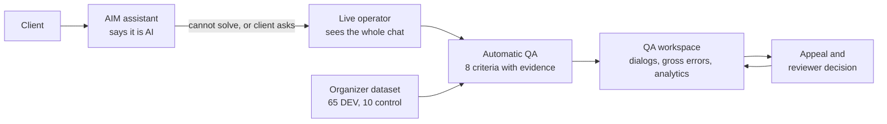
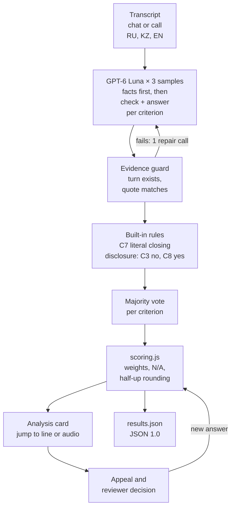
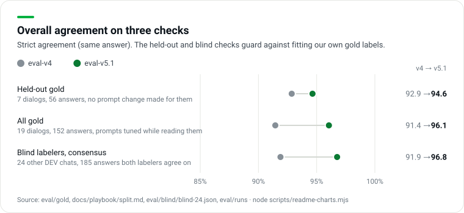

# Freedom CQA

**Every operator chat and call checked against Freedom Broker's 8-criterion checklist, with the exact line behind each deduction and a human reviewer who has the final word.**

Freedom Broker's QA team checks conversations by hand. Volume is large, one manual check per dialog is not enough, and people read the same metric differently ([briefing notes](docs/case/briefing-notes.md)). Freedom CQA evaluates every dialog in Russian, Kazakh and English. A model picks the answer and the evidence line for each criterion, code computes the points, and a reviewer can overturn any answer through an appeal. On the customer side, the AIM assistant says it is AI and hands the client to a live operator with the full context; that operator's work then goes through the same QA.

Built in 24 hours by team **YaTebyaMognu** for the Freedom Broker case at NU Datathon 2026 (Data Challenge'26, NU DataSci club, Nazarbayev University).

[](landing-tair/assets/demo.mp4)

*Click the image for the demo video.*

## Try it

Production: **https://freedom-cqa.vercel.app**

| Surface | Link | What you see |
|---|---|---|
| Landing | [/](https://freedom-cqa.vercel.app/) | The product story and the way into support |
| Customer chat | [/support/](https://freedom-cqa.vercel.app/support/) | AIM answers, says it is AI, hands off to a live operator with the whole chat, asks for CSAT; the operator's part is then evaluated |
| QA workspace | [/admin/](https://freedom-cqa.vercel.app/admin/) | Обзор, Диалоги, analysis card, Апелляции, Чек-лист, Живые чаты, AI-аналитик. The demo passcode is printed on the login page |
| Client app demos | [/broker/](https://freedom-cqa.vercel.app/broker/) · [/phone/](https://freedom-cqa.vercel.app/phone/) | A broker web app and a copy of the Freedom iOS app with AIM inside: explains steps, acts only after the client agrees, never presses money buttons |
| Original workspace | [/prototype/](https://freedom-cqa.vercel.app/prototype/) | The first analyst workspace, kept in sync with `/admin/` |
| Preview hub | [/preview-hub/](https://freedom-cqa.vercel.app/preview-hub/) | Every surface on phone, tablet and laptop, build and AI status |

**Model and cost (required by the brief):** OpenAI **GPT-6 Luna** (`openai:gpt-6-luna`), 3 samples per dialog. About **$0.007 per evaluation**, all model calls included (measured on 65 DEV dialogs). Details in [Models, cost, latency](#models-cost-latency).

### At a glance

| Question | Answer (evaluator `eval-v5.3`) | Source |
|---|---|---|
| Agreement with our gold labels, per criterion answer | **95.4% strict**, 98.7% lenient (19 dialogs, 152 answers) | [v5.3 report](eval/runs/2026-11-07T16-05-00Z-v53-report.md) |
| Same, on the 7 held-out gold dialogs | **96.4% strict**, 100% lenient (56 answers) | same |
| Agreement with two blind AI labelers, 24 other DEV chats | **97.3%** (180 of the 185 answers they agree on) | [`eval/blind/`](eval/blind/blind-24.json) |
| Gross errors on gold | **7 of 7 found, 0 false alarms** | [v5.3 report](eval/runs/2026-11-07T16-05-00Z-v53-report.md) |
| Cost per evaluation | ≈ $0.006 per chat, ≈ $0.016 per call (3 votes, all calls); $0.0070 average over all 65 DEV dialogs | [v5.3 run](eval/runs/2026-11-07T16-02-37-681Z-v53-dev-DEV.json), [v5.1 run](eval/runs/2026-11-07T15-00-49-475Z-v51-dev-DEV.json) |
| 10 control chats | 79 s and $0.064 in a full rehearsal of the 11:00 procedure, error path included | [v5.3 report](eval/runs/2026-11-07T16-05-00Z-v53-report.md) |
| Tone of voice on calls (c09, Gemini 3.8 Flash listens to the mp3) | ≈ $0.013 per call; on DEV 1 of 5 calls lowered (p4-ru-001 → 4/10: cold, detached tone the client remarks on) | [`eval/runs/`](eval/runs/) `*-DEV-tone.json` |

> `eval-v5.3` replaced `eval-v5.1` on Saturday evening under the rule we fixed in advance: held-out and blind consensus must not drop, gross errors must stay 7/7 with 0 false alarms. v5.1 scored 96.1% on all gold but 94.6% held-out and 96.8% blind; v5.3 trades one all-gold answer for better held-out, blind and C2/C5 consistency. Full comparison: [v5.3 report](eval/runs/2026-11-07T16-05-00Z-v53-report.md).

Every number in this README is recomputed by `node scripts/readme-charts.mjs` from committed files, or quoted from the linked run file or report.

### Коротко по-русски

Модель по каждому критерию выбирает только ответ (да / нет / N/A или ступень шкалы) и реплику-доказательство. Баллы считает код по правилам чек-листа: «да» даёт полный вес, шкала пропорциональна весу, вес критериев с N/A перераспределяется, итог округляется один раз, half-up, до двух знаков. Грубые ошибки отмечаются отдельно и баллов не дают. Спорные места решаем так, как ответили организаторы: C2 = N/A при полном запросе, C7 читаем буквально, C1 на звонках без записанного приветствия = N/A, раскрытие данных до идентификации = C3 «нет» и грубая ошибка. Любой ответ можно оспорить; решение проверяющего пересчитывает итог.

## Contents

- [The jury's live tasks](#the-jurys-live-tasks) · [Screenshots](#screenshots) · [The six must-haves](#the-six-must-haves)
- [How evaluation works](#how-evaluation-works) · [Accuracy](#accuracy) · [Research findings](#research-findings)
- [Models, cost, latency](#models-cost-latency) · [Run it](#run-it) · [Control set](#control-set-procedure)
- [Architecture and Dynamics 365](#architecture-and-dynamics-365-readiness) · [Limitations](#limitations) · [Team](#team)

## The jury's live tasks

The organizers listed what they will ask for in the live demo ([telegram-qa.md](docs/case/telegram-qa.md), #2991). All of it runs in `/admin/`.

| Ask | Where | What happens |
|---|---|---|
| Show all dialogs with gross errors and why | Обзор → KPI «Грубые ошибки», or Диалоги → «Грубые ошибки» | A list of every flagged dialog with the AI explanation and the operator line that proves it. On DEV, eval-v5.3 flags 8 of 65 dialogs |
| Send a result to appeal | Card → «Оспорить» on a criterion → comment → save | The appeal goes to «Апелляции» with the disputed answer, the comment and the dialog fragment |
| Reviewer decision | Role switch «Проверяющий» → «Принять решение» | Confirm or change the answer with a reason. `prototype/scoring.js` recomputes the total; the card shows the original score, the decision and the final score |
| Change the checklist and re-evaluate | Чек-лист → add, edit, replace, reorder a criterion or change a weight → «Сохранить vN и переоценить» | A new checklist version is saved and every dialog is evaluated again with it. Chats and calls have separate checklists |
| Justify one dialog's score | Диалоги → any row | Per criterion: answer, points, weight, explanation, evidence. Click a deduction to scroll to and highlight the line; on calls the player jumps to that moment |

## Screenshots

<table>
<tr>
<td width="50%"><br><sub>/support/: AIM says it is AI and hands off with the whole chat and an expected wait</sub></td>
<td width="50%"><br><sub>Обзор: average score, points lost per criterion, what to fix first</sub></td>
</tr>
<tr>
<td><br><sub>Грубые ошибки: every flagged dialog with the reason and the operator line</sub></td>
<td><br><sub>Analysis card: transcript, score ring, «Причина снижения оценки», evidence jump</sub></td>
</tr>
<tr>
<td><br><sub>Call card: per-speaker timeline, player seeks to the evidence moment</sub></td>
<td><br><sub>Апелляция: original answer, reviewer decision with reason, new total</sub></td>
</tr>
<tr>
<td><br><sub>Чек-лист: criteria, weights, answer types, N/A rules, versions</sub></td>
<td><br><sub>AI-аналитик: questions about the aggregated QA data</sub></td>
</tr>
</table>

## The six must-haves

From the [brief](docs/case/brief.md).

| # | Must-have | Where in the product |
|---|---|---|
| 1 | **Checklist editor:** add and edit criteria, wording, weight, answer type, N/A, scale; a new criterion applies through the UI; save the configuration | `/admin/#/checklist`. Each save is a new version. The checklist is JSON data ([`data/checklists/`](data/checklists/)); nothing in the evaluator is hard-coded per criterion id |
| 2 | **Evaluate a dialog** in RU / KZ / EN; bot and system lines are context | Card → «Оценить заново» → `POST /api/evaluate` → [`lib/evaluator.js`](lib/evaluator.js). Only the operator is graded |
| 3 | **Show the result:** answer, points, weight, explanation, evidence; the checked range for a missed action; the reason for N/A; total and section subtotals | Analysis card: score ring, «Итоги по секциям», every criterion with its justification, gross-error banner |
| 4 | **Card with evidence jump;** for calls, a player | Click a deduction or a timeline marker: the transcript scrolls to the line and highlights it; calls seek the recording through [`/api/audio`](lib/audio.js) |
| 5 | **Appeal:** pick a criterion, comment, save; the reviewer sees the score, comment and fragment | «Оспорить» on the card → «Апелляции» queue |
| 6 | **Decision:** confirm or change with a reason; the total recalculates; original, decision and final are shown | Reviewer role in the card and in «Апелляции»; the same scoring engine recomputes the total |

No login is needed for the QA flow, as the brief allows. The admin console has a passcode only to keep it apart from the public pages.

### The product loop



## How evaluation works



| Step | What it does | Why |
|---|---|---|
| Facts first | One call per sample. The schema makes the model fill dialog facts before any verdict: client requests and outcome, first operator turn, verification turn, disclosure / insult / off-company offer turns, client re-asks and their cause, how the chat ended, goodbye / summary / offer turns. Then a short `checks` line per criterion, then the answer | Decomposing a fuzzy criterion into checkable questions and filling facts before scoring makes LLM judges more reliable ([CheckEval](https://arxiv.org/abs/2403.18771), [G-Eval](https://arxiv.org/abs/2303.16634)); in contact-center QA, "find evidence, reason, then answer" helped ([Ingle et al., EMNLP 2024](https://aclanthology.org/2024.emnlp-industry.60)) |
| Playbook procedures | The prompt carries a decision procedure per criterion, written by meaning (greeting, need, identification, resolution, empathy, dialog management, closing, gross violation), with RU / KZ / EN cues | An edited or new criterion falls back to its own text, so the live "replace a criterion" test needs no code change ([scoring playbook](docs/playbook/scoring-playbook.md)) |
| Evidence guard | Turn indices must exist, quotes must match the cited line, every scored or flagged answer needs a reference, N/A evidence only for an allowed N/A. Any problem triggers one repair call; still incomplete → an error, never a half result | Judges can invent evidence; the organizers said "don't invent facts" (#2981) |
| Built-in rules | For the unchanged official criteria only: C7 from the closing facts (literal ruling), disclosure before verification → C3 "no" and C8 "yes", insult or off-company offer → C8 "yes". Turned off when a criterion's text, type or N/A rule is edited | Mechanical rules belong in code ([MLflow on judge calibration](https://mlflow.org/articles/llm-judge-calibration/)). On 65 DEV dialogs × 3 samples they never had to override the model; they are a safety net |
| 3 samples + vote | Majority per criterion; ties go to the median scale step, else the most central sample. The agreement share is returned per criterion so low-agreement answers can go to a human first | Judges are self-inconsistent; a majority over 3 runs beat single runs ([Rating Roulette](https://arxiv.org/pdf/2510.27106)). eval-v4 runs flipped 6.6% of answers; v5.x is estimated at about 2% |
| Deterministic scoring | [`prototype/scoring.js`](prototype/scoring.js), one pure function used by the UI, the API, the exporter and the accuracy harness | The model never does arithmetic. Re-scoring after an appeal costs nothing and is reproducible |
| Appeal → review | A disputed answer is replaced by the reviewer's answer and scored by the same function. Original, decision and final are kept | Freedom's slide: "a human keeps control" ([opening ceremony](docs/case/opening-ceremony.md)) |

### Scoring rules (from the checklist)

| Rule | Implementation |
|---|---|
| Yes = full weight, No = 0; scale points = weight × step / top step | `rawPoints()` |
| N/A only where allowed **and** its condition is met; N/A weight is redistributed so the maximum stays 100 | total = Σ points / Σ applicable weights × 100 |
| Round the total, not each line: half-up to 2 decimals (50.625 → 50.63) | `round2()`, applied once to the final total |
| No applicable weighted criterion → total not calculated | `total: null` |
| Gross errors (C8) carry no points and never zero the total; shown as a separate red flag | `gross_error` |

Worked example, DEV chat `p1-ru-001` (eval-v5.3): C2 and C3 are N/A (clear request, no account data), so 35 of 100 weight drops out. C7 is "no": «Пожалуйста. Хорошего вечера!» has a goodbye but no summary and no offer of help. Points 10 + 20 + 15 + 15 + 0 = 60 of an applicable 65 → **92.31**.

### Organizer rulings we follow

From the Q&A chat ([telegram-qa.md](docs/case/telegram-qa.md)); where each one lives in code: [organizer-rulings.md](docs/research/organizer-rulings.md).

| Topic | Ruling | What the product does |
|---|---|---|
| C2, client gave everything up front | N/A (#2814) | A clear, complete request is N/A, not "yes" and not "no" |
| C7, only «Пожалуйста. Хорошего вечера!» | Re-read the checklist: (summary **or** offer of help) **and** goodbye (#2814, #3024) | Literal reading in `closingAnswer()`; a pleasantry plus goodbye is "no". One function to flip if the experts read it otherwise |
| C1 on calls with no recorded greeting | N/A (#2978) | The call checklist ([`freedom-call-v1.json`](data/checklists/freedom-call-v1.json)) allows C1 N/A when the greeting is not in the recording |
| Account data before identification | C3 "no"; C8 is our choice (#2814) | C3 "no" **and** C8 gross error. Verification steps themselves are not disclosure |
| When identification is needed | Decide from the request; being in the app is not verification (#3074, #3082) | Only a verification event or a completed verification step counts |
| Rounding | Half-up to 2 decimals (#2978) | `round2()` on the total only |
| Replacing a criterion | Re-evaluate: yes (#2978) | The cache key includes the full criteria, so any checklist change means a fresh model call per dialog |
| Missing information | Don't invent facts (#2981) | Evidence guard; C4 does not mark a confident answer wrong without a visible contradiction (no knowledge base was given) |
| 3-minute first reply | SLA, out of scope (#3088) | Not scored |

## Accuracy

The organizers pick the top 50 mainly by **per-criterion agreement with expert labels on 10 unseen control chats** ([telegram-qa.md](docs/case/telegram-qa.md), #2292, #2978). We measure the same thing.




| Check | Answers | eval-v4 | eval-v5.3 |
|---|---|---|---|
| Held-out gold (7 dialogs) | 56 | 92.9% strict / 96.4% lenient | **96.4% / 100%** |
| All gold (19 dialogs) | 152 | 91.4% / 96.7% | **95.4% / 98.7%** |
| Blind labelers' consensus (24 other chats) | 185 | 91.9% (170) | **97.3% (180)** |
| C6 dialog management, all gold | 19 | 57.9% | **78.9%** (94.7% lenient) |
| Gross errors on gold | 7 | 7 found, 0 false | 7 found, 0 false |
| By language, all gold, strict | RU 72 · KZ 40 · EN 40 | 87.5 · 92.5 · 97.5 | 91.7 · 97.5 · 100 |

### What these numbers mean

- **Gold labels are ours.** 19 DEV dialogs × 8 criteria = 152 answers. An agent drafted them, then a human reviewer checked every label and accepted all of them ([`eval/gold/README.md`](eval/gold/README.md)). A separate audit re-read all 19 against the checklist: 84 completeness fixes, no answer changed, all 7 gross errors confirmed ([gold audit](eval/GOLD_AUDIT_REPORT.md)). Borderline labels list defensible alternatives in `also_acceptable`.
- **Strict** = the same answer as gold. **Lenient** = gold or one of its accepted alternatives.
- **Held-out** means "no prompt change was made in response to these 7 dialogs", not "never seen". The split (12 tuning, 7 held-out, stratified by language and case type) was frozen before the first eval-v5 call ([split.md](docs/playbook/split.md)), but eval-v4 and the v5 rules were written after reading all 19. With 56 answers, one answer is 1.8 points.
- **Blind double labeling** checks that we did not just fit our own reading. Two independent AI labelers (separate Claude sessions, a different model family from our GPT evaluator) saw only the checklist and the organizer rulings, no playbook and no model output, and labeled 24 non-gold DEV chats. They agreed with each other on 185 of 192 answers (96.4%); we score against those 185. They are not people and not Freedom's experts: a consistency check, not ground truth ([`blind-24.json`](eval/blind/blind-24.json)).
- **The real test** is the 10 control chats graded by Freedom's experts. We have no labels for them.

### Where eval-v5.3 still disagrees with gold

7 of 152 answers differ from gold; 2 are outside the accepted alternatives ([v5.3 report](eval/runs/2026-11-07T16-05-00Z-v53-report.md)):

| Dialog | Criterion | Ours vs gold | Note |
|---|---|---|---|
| p1-kz-015 | C6 | 10 vs 4 | ours: the client had to ask for the reason again; C6 is the noisiest criterion (two draws differ on 3 of 10 C6 answers) |
| p4-ru-001 (call) | C4 | 20 vs 10 | ours: the operator explained the support scope, not how to get a personal manager |

Fixed since eval-v5.1: p1-ru-009 C2 (the operator's clarifying question can no longer be N/A), p1-kz-008 C5 (irritation at being asked again), the EN/RU twins p1-en-007 / p1-ru-007 now get the same C2 and C5.

### How we got here


- **GPT-6 Luna over Claude Haiku 5.5** on the same prompt: 86.2% vs 75.7% strict, total score error 7.83 vs 14.06 points, $0.00112 vs $0.00177 per evaluation ([our-experiments.md](docs/research/our-experiments.md) §4).
- **eval-v3 was rejected despite the higher score.** On dialogs outside the gold set it flagged gross errors on two real calls where the operator was only verifying identity. A false gross error on a real operator is worse than one point of agreement.
- **eval-v5.2 was rejected.** Rules taken from the blind labels gained 2 answers on the blind set but lost 2 strict answers on held-out gold (rule: held-out must not drop). Diff kept in [`eval-v5.2-candidate.diff`](docs/playbook/eval-v5.2-candidate.diff).
- Total paid spend on the v5 work: $1.42.

Reproduce:

```bash
node scripts/readme-charts.mjs                    # recomputes every number above, redraws the three charts
node --experimental-strip-types eval/accuracy.ts \
  eval/runs/2026-11-07T15-00-49-475Z-v51-dev-DEV-openai_gpt-6-luna.evaluations.json --reviewed-only --verbose
python3 -I eval/blind/compare.py eval/blind/blind-24.json \
  v51=eval/runs/2026-11-07T15-00-49-475Z-v51-dev-DEV-openai_gpt-6-luna.evaluations.json
```

Node ≥ 23.6 runs `.ts` files without the flag.

## Research findings

Full pages and sources: [research index](docs/research/README.md). Outside facts carry a link; where we could not verify a number, the page says so.

### How we are judged → [organizer-rulings.md](docs/research/organizer-rulings.md)

| Finding | What we did |
|---|---|
| Top 50 are picked mainly by per-criterion agreement with experts on 10 unseen chats; exact match isn't required, sensible N/A and gross-error handling is (#2292, #2978) | Measure strict and lenient agreement per criterion and language on gold, plus N/A and gross-error recall ([`eval/accuracy.ts`](eval/accuracy.ts)) |
| The system must really analyse new dialogs; hard-coding results is the one thing not allowed (#2177) | Every dialog goes through `/api/evaluate`; committed results are only a cache keyed by model, prompt, transcript and checklist |
| The README is read, the code is not run (#2980) | This page, with charts generated from the committed runs |

### LLM as a judge → [llm-as-judge.md](docs/research/llm-as-judge.md)

| Finding | What we did |
|---|---|
| A strong judge can match human–human agreement (over 80% on MT-Bench, [Zheng et al. 2023](https://arxiv.org/abs/2306.05685)), but agreement swings with the task: 11 LLMs on 20 datasets ([Bavaresco et al., ACL 2025](https://arxiv.org/abs/2406.18403)) | Validate per criterion, never one overall number. C6 was 57.9% under eval-v4 and got its own procedure |
| Judges are biased: answer order alone made one model win 66 of 80 comparisons; writing evidence before the verdict reduced bias ([Wang et al., ACL 2024](https://arxiv.org/abs/2305.17926)) | Facts and a check line come before every answer; the guard rejects evidence that is not in the transcript |
| Judges are inconsistent across runs; a majority vote over 3 runs beat single runs ([Rating Roulette](https://arxiv.org/pdf/2510.27106)) | 3 samples and a vote. Measured flips between two eval-v4 runs: 10 of 152 answers (6.6%); eval-v5.x estimated at about 2% |

### Kazakh, Russian, English → [languages-kz-ru-en.md](docs/research/languages-kz-ru-en.md)

| Finding | What we did |
|---|---|
| Kazakh is still low-resource: on KazMMLU (about 23,000 questions) the best models fall well short of their high-resource results ([Togmanov et al., ACL 2025](https://arxiv.org/abs/2502.12829)) | Report KZ separately: 97.5% strict on 40 KZ gold answers, which is 5 dialogs, so within noise |
| Zero-shot Whisper-large had 43.58% WER on FLEURS Kazakh ([Li et al., Interspeech 2024](https://arxiv.org/abs/2408.05554)); Kazakh–Russian code-switching is common ([KSC2](https://www.isca-archive.org/interspeech_2022/mussakhojayeva22_interspeech.html)) | Grade calls on the organizer transcripts; never penalise the operator for garbled ASR words; a Russian menu path in a KZ reply is not a language error |
| Keyword rules break across languages; JavaScript `\b` ignores Cyrillic | Rules describe behaviour, not words; quotes stay in the original language, explanations are in Russian |

### Trust and the bot → human handoff → [trust-and-handoff.md](docs/research/trust-and-handoff.md)

| Finding | What we did |
|---|---|
| 64% of 5,728 customers would prefer companies not use AI in service; the top worry is losing access to a person ([Gartner 2024](https://www.gartner.com/en/newsroom/press-releases/2024-07-09-gartner-survey-finds-64-percent-of-customers-would-prefer-that-companies-didnt-use-ai-for-customer-service)). Regulators describe chatbot "doom loops" with no way out ([CFPB 2023](https://files.consumerfinance.gov/f/documents/cfpb_chatbot-issue-spotlight_2023-06.pdf)) | A "talk to a person" option is always visible; account, money, blocked-account questions and unhappy clients go to a human |
| Disclosing a bot up front cut purchases by 79.7% in a field experiment ([Luo et al. 2019](https://doi.org/10.1287/mksc.2019.1192)), yet disclosure is law: Kazakhstan's AI law from 18 Jan 2026, EU AI Act Art. 50 from 2 Aug 2026 | AIM says it is AI and does not invent tariffs, numbers, dates or links ([`lib/support-bot.js`](lib/support-bot.js)) |
| Freedom's own slide: «Я передам вопрос специалистам», and the client still doesn't know when an answer comes ([opening ceremony](docs/case/opening-ceremony.md)) | The handoff says the specialist sees the whole chat and when to expect a reply. QA gives full C4 points to a handoff only if the data was collected and the client was told what happens next |

### Contact-center QA → [qa-and-speech-analytics.md](docs/research/qa-and-speech-analytics.md)

| Finding | What we did |
|---|---|
| Manual QA covers a few percent of conversations (vendor figures 2–5%; we found no independent benchmark) | Score every dialog; at $0.007 per evaluation, 10,000 dialogs cost about $70 in model fees (arithmetic) |
| QA teams calibrate: several analysts score the same conversation and discuss differences ([SQM Group](https://sqmgroup.com/resources/library/blog/call-calibration-comprehensive-guide)); vendors advise validating AI on 20–30 analyst-scored calls ([Aircall](https://aircall.io/blog/ai-quality-assurance-call-center/)) | Gold set + blind double labeling play the role of calibration; disagreements are listed per criterion |
| Freedom's brokerage had about 858,000 accounts on 31 Mar 2026 ([FY2026 results](https://ir.freedomholdingcorp.com/press-releases/detail/99/)) | Analytics in `/admin/`: average score by language and channel, points lost per criterion, common deduction reasons, AI analyst |

### Models, cost, latency → [models-cost-latency.md](docs/research/models-cost-latency.md)

| Finding | What we did |
|---|---|
| GPT-6 Luna: $0.10 input / $0.50 output per 1M tokens, structured outputs ([OpenAI](https://developers.openai.com/api/docs/models/gpt-6-luna)) | Default evaluator, chosen on gold agreement, error and cost |
| QA runs after the conversation, so seconds are fine; a live voice agent needs about 500 ms ([briefing notes](docs/case/briefing-notes.md)) | Batch evaluation with 3 samples (32 s per chat); voice replies start with the first sentence (about 1.1–1.5 s) |

### Freedom's own products → [freedom-app.md](docs/research/freedom-app.md), [design-system.md](docs/research/design-system.md)

| Finding | What we did |
|---|---|
| Support in the Freedom iOS app (v32.23.17) is an async ticket form with no instant answers | `/phone/`: AIM at the top of the Поддержка sheet, handing off to the ticket form |
| fbroker.kz is built on Tailwind, so its theme can be read back from class names | Design tokens and the Freedom greens come from the site; the organizers asked for a corporate look, nothing cartoonish (#3011) |

## Models, cost, latency

| Job | Model | Via | Cost | Latency |
|---|---|---|---|---|
| **Evaluate a dialog** | `openai:gpt-6-luna`, prompt `eval-v5.3`, 3 samples, strict JSON schema | OpenAI API (falls back to OpenRouter `openai/gpt-6-luna` without `OPENAI_API_KEY`) | **$0.0070 per evaluation**, all calls (3 samples + repair calls on about 9% of samples). Chats $0.0061, calls $0.018 | chats p50 32 s / p95 62 s; calls p50 128 s / p95 153 s; cached ≈ 20 ms |
| AIM support bot, navigation agent | `openai:gpt-6-luna` | OpenAI API | ≈ $0.001 per turn (estimate) | ≈ 2 s chat; 4–8 s navigation (local) |
| AIM microphone | OpenAI `whisper-1`; fallback NVIDIA Nemotron 3.5 Transcribe | OpenAI / OpenRouter | $0.006 per audio minute | p50 1.2 s / p95 2.5 s cold; 3–5 ms cached |
| AIM voice | OpenAI `gpt-4o-mini-tts`, voice `sage` | OpenAI | ≈ $0.015 per spoken minute (estimate) | p50 1.4 s / p95 1.75 s per chunk cold; first sentence 1.1–1.5 s |
| Call transcription experiment | `nvidia/nemotron-3.5-transcribe` | OpenRouter | $0.041 for all 5 calls | 10–18 s per call |

Sources: [eval-v5.1 run summary](eval/runs/2026-11-07T15-00-49-475Z-v51-dev-DEV.json) (all 65 DEV dialogs fresh, 0 errors, $0.457 total), [eval-v5.3 run summary](eval/runs/2026-11-07T16-02-37-681Z-v53-dev-DEV.json) (22 fresh: chats $0.0058, p50 27.5 s / p95 44.8 s; calls $0.016, ≈ 155 s), [v5 report](eval/runs/2026-11-07T15-15-00Z-v5-report.md) §6, voice benchmarks in `eval/runs/voice-bench-*.json`, [TOOLING.md](docs/TOOLING.md) §4. Latency is model time per dialog with the 3 samples in parallel. eval-v5.x costs about 6× eval-v4 ($0.0012) and takes about 2× as long; we pay that for the accuracy above.

- **Caching.** Every model call goes through [`lib/cache.js`](lib/cache.js). The key holds the model, prompt version, conversation, full transcript, checklist criteria, sample number and a fingerprint of the logic file (`lib/evaluator.js` for evaluation). An identical request is free and returns in milliseconds; any change to the evaluator code or the checklist produces a fresh answer. Paid answers are committed in `eval/cache/`, so teammates and Vercel reuse them.
- **Re-scoring is free.** An appeal decision only re-runs `prototype/scoring.js` on stored answers. A checklist change re-runs the model, as the organizers ruled.
- **Speech-to-text quality.** On the 5 DEV calls Nemotron got WER 35.5% / CER 24.4% against the organizer transcripts. Those transcripts are machine output too, so this is agreement between two ASR systems, not accuracy. Calls are graded on the organizer transcripts.

## Run it

```bash
git clone https://github.com/tairqaldy/doomdatathon-yatebyamognu.git && cd doomdatathon-yatebyamognu
cp .env.example .env    # OPENAI_API_KEY (evaluation, voice), OPENROUTER_API_KEY (call ASR), CQA_API_URL (dataset API);
                        # optional: DATABASE_URL or Upstash Redis for live chats across devices
npm run dev             # Node >= 20, no npm dependencies -> http://localhost:3000 (same code as Vercel)
```

Without keys the UI runs on the AI results already committed in `data/evaluations/` and a clearly labelled offline evaluator for new dialogs.

```bash
npm test                                  # scoring rules: weights, scale, N/A redistribution, half-up rounding
npm run eval -- --group DEV               # evaluate DEV -> data/evaluations/DEV.json + eval/runs/<ts>-DEV.json (cost, latency)
npm run results -- --group DEV            # fetch, evaluate, export, validate -> results/dev/results.json (JSON 1.0)
node scripts/readme-charts.mjs            # accuracy numbers and README charts
npm run asr                               # transcribe the 5 calls, WER/CER vs organizer transcripts
scripts/check.sh                          # pre-merge gate: JSON valid, no secrets, tests
```

Accuracy harness and blind comparison: see [Accuracy](#accuracy). Useful `npm run eval` flags: `--only <ids>`, `--prompt eval-v4`, `--samples <k>`, `--concurrency <n>`.

## Control set procedure

Timeline: start Sat 2026-11-07 12:00 → control transcripts Sun 11:00 → **stop code Sun 12:00**. One hour for 10 control chats ([results-format.md](docs/case/results-format.md)).

From an up-to-date `main` with keys in `.env`:

```bash
npm run results -- --group <CONTROL_ID> --push
```

[`eval/control-run.mjs`](eval/control-run.mjs) fetches the set from the organizers' API (or our `/api/dataset` proxy), evaluates every chat (cached, 8 in parallel), retries failures once, writes `results/prod/results.json` in the appendix's "Формат JSON 1.0", validates it and commits and pushes. The validator checks exactly 10 records, all 8 criteria per record, 1-based turn numbers over the full transcript, `final_score` recomputed independently with half-up rounding, and failed dialogs as `status: "error"` with a reason, never a made-up score. Expected: about 3 minutes and $0.07. Then spot-check gross errors and N/A answers in `/admin/`.

After stop code: no commits. Data processing and checklist edits through the UI are still allowed.

## Architecture and Dynamics 365 readiness

| Layer | What | Where |
|---|---|---|
| UI | Plain static HTML, CSS and JS (ES modules), no build step, no framework, hash routing | [`landing-tair/`](landing-tair/), [`support/`](support/), [`admin/`](admin/), [`broker/`](broker/), [`phone/`](phone/), [`prototype/`](prototype/), [`shared/`](shared/), [`design/`](design/) |
| API | Vercel serverless functions, plain Node ESM, zero npm dependencies; `npm run dev` runs the same code locally | [`api/`](api/), [`lib/`](lib/) |
| Models | One router: `openai:<id>` → OpenAI API, anything else → OpenRouter | [`lib/llm.js`](lib/llm.js) |
| Scoring | One pure function for UI, API, exporter and harness | [`prototype/scoring.js`](prototype/scoring.js) |
| Cache | memory → committed `eval/cache/` files → optional Upstash Redis or Cloudflare KV | [`lib/cache.js`](lib/cache.js) |
| Storage | Datasets, checklists and results as committed JSON; checklist versions and appeals in the browser's localStorage; live chats in optional Postgres or Redis | [`data/`](data/), [`results/`](results/) |

API: `POST /api/evaluate` · `GET /api/dataset?group_id=` · `GET /api/audio?id=` (organizer audio links expire after about 1 h) · `POST /api/transcribe` · `POST /api/chat` · `POST /api/agent` · `POST /api/agent-voice` · `GET/POST /api/speak` · `POST /api/insights` · `POST /api/admin-login` · `GET/PUT/DELETE /api/sessions` · `GET /api/health`. Shapes: [CONTRACTS.md](docs/CONTRACTS.md).

**Dynamics 365.** The brief asks for a UI that can later become a Dynamics 365 HTML web resource.
- Ready: static files only, no build step, no framework; ES modules; hash routing; the dataset is fetched server-side, so the browser never hits the organizers' CORS limits.
- The `/prototype/` workspace mounts in one root element (`#cqa-root`) and loads its styles and data by relative paths.
- Still to do: `/admin/` uses root-absolute paths (`/shared/…`, `/api/…`); embedding needs them relative and one API base URL pointing at the hosted backend. We have not tested inside a Dynamics 365 org. For the handoff side, Copilot Studio already passes the full conversation to a Dynamics 365 agent ([Microsoft Learn](https://learn.microsoft.com/microsoft-copilot-studio/advanced-hand-off)).

### Repo map

| Path | What |
|---|---|
| `landing-tair/`, `support/`, `admin/`, `broker/`, `phone/`, `prototype/`, `preview-hub/` | The surfaces listed under [Try it](#try-it) |
| `shared/`, `design/` | Light theme, Freedom logo, design tokens, shared voice client, live-chat store |
| `api/`, `lib/` | Serverless endpoints; evaluator, model router, cache, audio, support bot, navigation agent |
| `data/` | DEV dataset, chat and call checklists, committed evaluations |
| `eval/` | Gold set, blind labels, accuracy harness, run files, cache, results exporter and validator, audits |
| `results/` | `dev/results.json` (65 dialogs) and, at control time, `prod/results.json` |
| `docs/` | Case files, research, scoring playbook, contracts, decisions, status log |
| `scripts/` | Dev server, eval and ASR runners, scoring tests, README charts, pre-merge check |

## Limitations

- **Our gold, not Freedom's.** 19 dialogs labeled by us; the blind labelers are AI sessions, not Freedom's experts. The control chats are the only expert test.
- **Small samples.** Held-out gold is 56 answers (one answer = 1.8 points); KZ and EN have 5 gold dialogs each.
- **C7 literal reading is a bet.** If the experts accept a polite goodbye after a solved request, we lose C7 on many chats (−5 points before redistribution). It is one function, `closingAnswer()`.
- **Weakest criteria:** C6 dialog management (84.2% strict) and C5 empathy (89.5%). C4 is slightly harsh on handoffs that were a correct next step.
- **Calls.** ASR noise can make an operator look worse on C1 and C6. An offline audit by Amina found call moments that need listening to the audio before any automatic fix ([TRANSCRIPT_FAIRNESS.md](docs/TRANSCRIPT_FAIRNESS.md), [TRANSCRIPT_VALIDATION.md](docs/TRANSCRIPT_VALIDATION.md), [NA_CACHE_COMPATIBILITY.md](docs/NA_CACHE_COMPATIBILITY.md)); its stricter guard is not wired into production.
- **Latency and limits.** 3 samples take about 32 s per chat. On Vercel's 60 s limit the vote uses the samples finished within 45 s.
- **Stability.** The 2% flip rate for eval-v5.x is estimated from sample agreement, not measured with a paid repeat run.
- **Shared state.** Appeals and checklist versions live in the reviewer's browser (localStorage), not on a server.
- **Handoff wait time** in `/support/` is a fixed demo text; in production it must come from real queue data.
- **Kazakh voice** has not been tested with a real speaker.

## Team

Team **YaTebyaMognu**, NU Datathon 2026, Freedom Broker case.

| Person | Lane |
|---|---|
| Tair Kaldybayev | Product, research, landing, support chat, admin console, pitch |
| Dameli Kalikhanova | QA workspace UX (`/prototype/`) |
| Nazar Akanov | Evaluator, gold set, AIM navigation agent, results export |
| Amina Aktayeva | Postgres and KV storage, transcript fairness and validation audits |

How we work (issues, small commits, lanes, AI call rules): [AGENTS.md](AGENTS.md). Every tool, model and library we used: [TOOLING.md](docs/TOOLING.md). Decisions: [DECISIONS.md](docs/DECISIONS.md).

## Acknowledgements

Thanks to **Freedom Broker** for the case, the DEV data, the checklist and fast answers in the Q&A chat, and to the **NU DataSci** club for organizing the datathon at Nazarbayev University.

## IP and licensing

- Images on the landing and support pages were generated for this project. Mood-board photos were only a reference and are not in the repo.
- Design tokens were read from fbroker.kz for Freedom's own case. We use the open Onest and Inter fonts instead of Freedom's licensed CoFo Sans. The Freedom logo appears only because this is Freedom's case.
- No third-party code is copied without a license. Visual references are linked, not vendored ([navigation-references.md](docs/research/navigation-references.md)). The unslop writing skill has no license file, so it was used locally only and is not in this repo.
