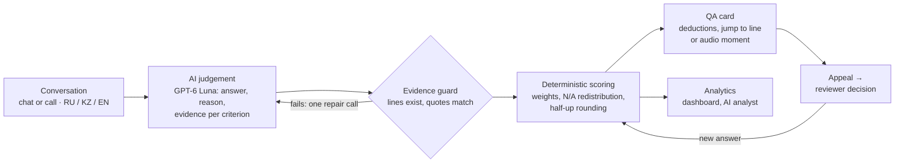
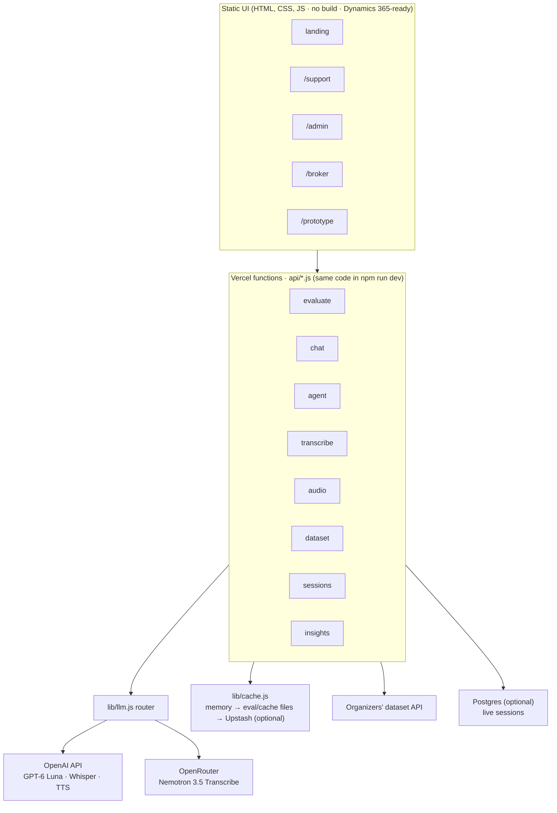

# Freedom CQA

**Every support chat and call checked against Freedom Broker's quality checklist, with the exact line behind each deduction and a human reviewer who has the final word.**

Built in 24 hours for the Freedom Broker case at the NU DataSci datathon 2026. Russian, Kazakh and English; chats and voice calls.


## Try it

| Surface | Link | What you see |
|---|---|---|
| Landing | https://freedom-cqa.vercel.app/ | The product story and the way into support |
| Support chat | [/support/](https://freedom-cqa.vercel.app/support/) | AIM, the AI assistant, with an honest handoff to a live operator |
| Admin console | [/admin/](https://freedom-cqa.vercel.app/admin/) | Live operator queue, QA dashboard, AI analyst. Passcode: ask the team |
| Client app with agent | [/broker/](https://freedom-cqa.vercel.app/broker/) | A demo broker app where AIM explains steps and fills forms only after the client agrees |
| Analyst workspace | [/prototype/](https://freedom-cqa.vercel.app/prototype/) | The QA workspace: dialog list, evaluation card, appeals, checklist editor |
| Preview hub | [/preview-hub/](https://freedom-cqa.vercel.app/preview-hub/) | Build info, AI status, accuracy, every surface on phone, tablet and laptop |

**Paid model and cost (required by the brief):** OpenAI **GPT-6 Luna**, about **$0.0011 per evaluation**, all calls included. Details in [Measured results](#measured-results).

## The problem

Freedom Broker's QA team reviews operator conversations by hand. Volume is large, one manual check per dialog isn't enough, and people read the same metric differently ([briefing notes](docs/case/briefing-notes.md)). Vendor guides put manual review at a few percent of conversations ([research](docs/research/qa-and-speech-analytics.md)). Freedom's brokerage business has about 858,000 accounts ([FY2026 results](https://ir.freedomholdingcorp.com/press-releases/detail/99/)).

Customers have a second problem: they don't trust AI support and want a real specialist ([briefing notes](docs/case/briefing-notes.md)). Freedom's own example: an operator says «Я передам вопрос специалистам», and the client still doesn't know when an answer will come ([opening ceremony](docs/case/opening-ceremony.md)).

Freedom CQA does both jobs. It scores 100% of conversations against the official 8-criterion checklist and explains every point lost. On the customer side, the assistant is open about being AI and hands off to a human with the full context.

## How it works



1. **Conversation.** Chats and calls come from the organizers' API. Bot replies and system events are context; only the operator is graded.
2. **AI judgement.** One model call per dialog returns, for each criterion, an answer, a short explanation, the reason for any deduction and the transcript lines that prove it.
3. **Evidence guard.** Cited lines must exist and quotes must match them. Any failure triggers one repair call; after that the API returns an error instead of a half-finished result.
4. **Deterministic scoring.** Code, not the model, turns answers into points ([`prototype/scoring.js`](prototype/scoring.js)).
5. **Appeal and review.** An operator disputes a criterion; a reviewer confirms or changes it with a reason; the total is recomputed. The card keeps the original, the decision and the final score.
6. **Analytics.** Average score by language and channel, points lost per criterion, common deduction reasons, and an AI analyst in `/admin/`.

## Как мы оцениваем

Модель по каждому критерию выбирает только ответ (да / нет / N/A или ступень шкалы) и указывает реплику-доказательство. Баллы считает код по правилам чек-листа: «да» = полный вес, шкала пропорционально весу, вес критериев с N/A перераспределяется, итог округляется один раз, half-up, до двух знаков. Грубые ошибки отмечаются отдельно и баллов не дают. Спорные места чек-листа мы решаем так, как ответили организаторы: C2 = N/A, если запрос был полным; C7 читаем буквально; раскрытие данных до идентификации = C3 «нет» и грубая ошибка.

Полные правила и разбор спорных случаев: [scoring playbook](docs/playbook/scoring-playbook.md). Решения организаторов и где они реализованы: [organizer-rulings.md](docs/research/organizer-rulings.md).

## The six must-haves, and where they are

| # | Must-have (from the [brief](docs/case/brief.md)) | Where in the product |
|---|---|---|
| 1 | **Checklist editor:** add and edit criteria, weight, answer type, N/A, scale; save; apply a new criterion through the UI | `/prototype/` → «Чек-лист». Each save is a new version, and every dialog is evaluated again against it; a checklist seen before is served from cache. The checklist is JSON data ([`data/checklists/`](data/checklists/)) |
| 2 | **Evaluate a dialog** in RU / KZ / EN; bot and system lines are context | `/prototype/` → dialog → «Оценить AI» → `POST /api/evaluate` ([`lib/evaluator.js`](lib/evaluator.js)) |
| 3 | **Show the result:** answer, points, weight, explanation, evidence per criterion; checked range for a missed action; reason for N/A; total and section subtotals | Evaluation card: score ring, sections, criteria, «Причины снижения», gross-error banner |
| 4 | **Card with evidence jump;** for calls, jump the audio player | Click a deduction or a timeline marker: the transcript scrolls to and highlights the line; calls seek the recording ([`/api/audio`](lib/audio.js)) |
| 5 | **Appeal:** pick a criterion, comment, save; reviewer sees score, comment and fragment | «Оспорить» on the card → «Апелляции» queue |
| 6 | **Decision:** confirm or change with a reason; total recalculates; original, decision and final shown | Reviewer role in «Апелляции»; recomputed by the same scoring engine |

No login is needed for the QA workspace, as the brief allows. The admin console has a passcode only to keep it separate from the public pages.

## Measured results

Gold set: 19 DEV dialogs (9 RU incl. 1 call, 5 KZ, 5 EN), 152 labels, every label reviewed by a human ([`eval/gold/`](eval/gold/README.md)). The organizers rank teams mainly by per-criterion agreement with experts ([telegram-qa.md](docs/case/telegram-qa.md)), so that is our headline metric.

| Metric | Result | Source |
|---|---|---|
| Agreement with human labels, per criterion | **91.4% strict · 96.7% lenient** | [`gpt-6-luna-eval-v4.metrics.json`](eval/runs/gpt-6-luna-eval-v4.metrics.json) |
| By language, strict | RU 87.5% · EN 97.5% · KZ 92.5% | same |
| Gross errors found | **7 of 7, 0 false positives** | same |
| N/A recall | 96.4% | same |
| Evidence: hit rate · invalid references | 92.8% · 0 | same |
| Total score error (MAE, 0–100 scale) | 6.06 points | same |
| Weakest criterion | C6 dialog management, 57.9% strict | same |
| Cost per evaluation | **$0.00114** (GPT-6 Luna, 1 call per dialog) | [`eval/runs/2026-11-07T13-16-16-814Z-DEV.json`](eval/runs/2026-11-07T13-16-16-814Z-DEV.json) |
| Latency per fresh evaluation | p50 14.9 s · p95 25.8 s; cached ≈ 20 ms | same |
| Reliability | 0 errors on all 65 DEV dialogs | same |
| Tone of voice on calls (c09, Gemini 3.8 Flash listens to the mp3) | **≈ $0.013 per call** (5 calls, $0.066); on DEV 1 of 5 calls lowered (p4-ru-001 → 4/10: cold, detached tone the client remarks on), 4 at 10/10 | [`eval/runs/`](eval/runs/) `*-DEV-tone.json` |
| Call transcription (5 RU calls, Nemotron 3.5) | WER 35.5% · CER 24.4% · $0.041 total | [`eval/runs/2026-11-07T09-59-34-660Z-asr.json`](eval/runs/2026-11-07T09-59-34-660Z-asr.json) |

How we got here (strict agreement): rule-based mock 61.8% → Claude Haiku 5.5 75.7% → GPT-6 Luna 86.2% → prompt eval-v4 91.4%. Two prompt versions were rejected, one of them despite a higher score, because it flagged gross errors on real calls where the operator was only verifying identity. Full story: [our-experiments.md](docs/research/our-experiments.md).

Caveats:
- We tuned prompts on these 19 dialogs, so they are a development set. The 10 control chats are the real test.
- The ASR reference is the organizer transcript, which is itself machine output with IVR prompts. WER/CER here measure agreement, not accuracy. Calls are graded on the organizer transcripts.
- The cost figure was measured before the bounded repair call was added; a repaired dialog costs up to two calls.

### AIM's voice (`/support`, `/broker`, `/phone`)

Hold or tap the mic: the browser's own recording (webm or mp4) goes to **OpenAI Whisper** (`whisper-1`). AIM's reply is read aloud with **OpenAI `gpt-4o-mini-tts`**, voice `sage`, with a calm, warm tone instruction. The reply is split into chunks, all fetched in parallel and played in order, so speech starts once the first sentence is ready. Every phrase is cached (`lib/cache.js`, plus a text → audio map in the browser), so a repeated reply plays with no API call. Without `OPENAI_API_KEY` the mic falls back to Nemotron and replies to the browser's `speechSynthesis`.

| Step | Cold p50 · p95 | Cached p50 · p95 | Cost |
|---|---|---|---|
| Speech-to-text, `/api/agent-voice` (Whisper) | 1197 · 2515 ms | 3 · 5 ms | $0.006 per audio minute ≈ $0.0005 per 5 s question |
| Text-to-speech, `/api/speak` (gpt-4o-mini-tts) | 1374 · 1750 ms | 3 · 4 ms | ≈ $0.015 per spoken minute ≈ $0.0015 per 100-character reply (estimated) |
| Time to first audio, 3-sentence reply | first sentence ≈ 1.1–1.5 s, whole reply 2.6–3.0 s | instant | |

12 synthetic RU/KZ/EN phrases per row, local dev server → OpenAI; [`eval/runs/voice-bench-http-*.json`](eval/runs/) and [`voice-bench-models-*.json`](eval/runs/), rerun with `node scripts/voice-bench.mjs --models` or `--http <base url>`. On the same clips `gpt-4o-transcribe` was faster than Whisper (p50 844 ms · p95 1166 ms, same price, CER 0.056 vs 0.064); switch with `CQA_OPENAI_ASR_MODEL=gpt-4o-transcribe`. `gpt-4o-mini-tts` beat `tts-1` (p50 1383 vs 1973 ms).

## Architecture



- **UI:** plain static files, one root element, relative paths, Freedom design tokens from fbroker.kz ([`design/`](design/), [design system](docs/research/design-system.md)). Works in a ~800 px iframe for a Dynamics 365 web resource.
- **Scoring:** one pure function, [`prototype/scoring.js`](prototype/scoring.js), used by the UI, the API and the eval scripts.
- **Models:** all calls go through [`lib/llm.js`](lib/llm.js) and are cached by model + prompt version + full input, so a repeated request is free. Paid answers are committed in `eval/cache/` for teammates and Vercel.
- **API:** `GET /api/health` · `POST /api/evaluate` · `POST /api/transcribe` · `GET /api/audio?id=` (organizer audio links expire after ~1 h) · `GET /api/dataset?group_id=` · `POST /api/chat` · `POST /api/agent` · `POST /api/agent-voice` · `GET/POST /api/speak` · `POST /api/insights` · `POST /api/admin-login` · `GET/PUT/DELETE /api/sessions`. Shapes: [CONTRACTS.md](docs/CONTRACTS.md).

Repo map: `landing-tair/` · `support/` · `admin/` · `broker/` · `prototype/` · `shared/` · `design/` · `api/` · `lib/` · `data/` · `eval/` · `scripts/` · `docs/` · team and agent rules in [AGENTS.md](AGENTS.md).

## Run locally

```bash
git clone https://github.com/tairqaldy/doomdatathon-yatebyamognu.git && cd doomdatathon-yatebyamognu
cp .env.example .env    # OPENAI_API_KEY (evaluation), OPENROUTER_API_KEY (transcription), CQA_API_URL (dataset API); DATABASE_URL optional
npm run dev             # Node ≥ 20, no dependencies → http://localhost:3000
```

Without keys the workspace runs on a built-in MOCK evaluator, clearly labelled, and on the AI results already committed in `data/evaluations/`. Without Node: `python3 -m http.server 8080` → http://localhost:8080/prototype/ (static, MOCK, no call audio).

```bash
npm test                                   # scoring rules: weights, scale, N/A redistribution, rounding
npm run eval -- --group DEV                # evaluate all DEV dialogs → data/evaluations/DEV.json + eval/runs/<ts>-DEV.json (cost, latency)
npm run asr                                # transcribe the 5 calls + WER/CER vs organizer transcripts
node eval/accuracy.ts <run>.evaluations.json --reviewed-only --verbose   # agreement with gold (Node ≥ 23.6)
npm run results -- --group DEV            # fetch/evaluate/export/validate → results/dev/results.json (official JSON 1.0)
```

## Control set at T+23h

Timeline: start Sat 2026-11-07 12:00 → control transcripts Sun 11:00 → **stop code Sun 12:00** ([telegram-qa.md](docs/case/telegram-qa.md)). We have one hour for 10 control chats.

One command, from an up-to-date `main` with keys in `.env` (lane C, `eval/control-run.mjs`):

```bash
npm run results -- --group <GROUP_ID> --push
```

It fetches the set from the organizers' API (`data/datasets/<GROUP_ID>.json`), evaluates every chat (cached, parallel), retries failures once, writes `results/prod/results.json` in the official "Формат JSON 1.0" ([docs/case/results-format.md](docs/case/results-format.md)), validates it (exactly 10 records, all 8 criteria, 1-based turns, failed dialogs as `status: "error"`, never a made-up score) and commits + pushes. Then spot-check gross errors and N/A answers in `/admin/`.

`--push` commits the results file together with the dataset, `data/evaluations/<GROUP_ID>.json`, `eval/cache/` and `eval/runs/`. Push before 12:00. After stop code: no commits; data processing and checklist edits through the UI are still allowed.

## Research

| Page | Topic |
|---|---|
| [Research index](docs/research/README.md) | All pages and the five findings that changed the product |
| [Organizer rulings](docs/research/organizer-rulings.md) | Each organizer answer mapped to the file that implements it |
| [Our experiments](docs/research/our-experiments.md) | Gold set, audit, model choice, prompt v1 → v4, evidence guards, rounding fix, ASR |
| [QA and speech analytics](docs/research/qa-and-speech-analytics.md) | Manual sampling vs full coverage, scorecards, calibration, Freedom's scale |
| [LLM as a judge](docs/research/llm-as-judge.md) | Agreement with humans, biases, why scoring is deterministic and appeals are human |
| [Kazakh, Russian, English](docs/research/languages-kz-ru-en.md) | Kazakh as a low-resource language for LLMs and ASR, code-switching |
| [Trust and handoff](docs/research/trust-and-handoff.md) | Customer trust in AI support, disclosure law, handoff with context and wait time |
| [Models, cost, latency](docs/research/models-cost-latency.md) | GPT-6 Luna and Nemotron 3.5 prices, our measured cost and latency |
| [Model candidates and metrics](docs/research/models-and-metrics.md) | Early candidate list and metric definitions |
| [Design system](docs/research/design-system.md) | Freedom tokens reverse-engineered from fbroker.kz |
| [Scoring playbook](docs/playbook/scoring-playbook.md) | How each criterion is scored, with edge cases |

## Team YaTebyaMognu

Tair Kaldybayev · Dameli Kalikhanova · Nazar Akanov · Amina Aktayeva

## Acknowledgements

Thanks to **Freedom Broker** for the case, the DEV data, the checklist and fast answers in the Q&A chat, and to the **NU DataSci** club for organizing the datathon at Nazarbayev University.

## IP and licensing

- All images on the landing and support pages were generated for this project. Mood-board photos were used only as reference and are not in the repo.
- Design tokens were reverse-engineered from fbroker.kz for Freedom's own case. We use Inter instead of Freedom's licensed CoFo Sans font. The Freedom logo appears only because this is Freedom's case.
- No third-party code is copied without a license. Visual references we looked at are linked, not vendored ([navigation-references.md](docs/research/navigation-references.md)). The unslop writing skill has no license file, so it was used locally only and is not in this repo ([TOOLING.md](docs/TOOLING.md)).
- Every tool, model and library we used is logged in [TOOLING.md](docs/TOOLING.md).
