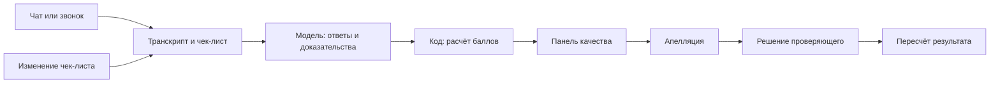

<div align="center">

# YaTebyaMognu — Team

## Freedom CQA

**Ни один разговор без проверки. Ни одна оценка без доказательства.**

Прототип контроля качества чатов и звонков Freedom Broker: от оценки по чек-листу и цитаты из разговора до апелляции и решения проверяющего.

[](https://freedom-cqa.vercel.app/)
[](https://freedom-cqa.vercel.app/admin/)
[](landing-tair/assets/demo.mp4)


**NU Datathon 2026 · Кейс Freedom Broker · Команда YaTebyaMognu**

</div>

---

## Для жюри: начните здесь

[](landing-tair/assets/demo.mp4)

[▶ Смотреть демо, 49 секунд](landing-tair/assets/demo.mp4) · [Панель качества](https://freedom-cqa.vercel.app/admin/) · [Клиентский чат](https://freedom-cqa.vercel.app/support/) · [Руководство для жюри, 12 страниц, PDF](docs/guide/freedom-cqa-guide.pdf) · [Презентация, 9 слайдов, PDF](pitch/freedom-cqa-slides.pdf) · [Презентация с видео, PPTX](pitch/freedom-cqa-defense.pptx)

> **95,4%** совпадения с разметкой команды на 19 диалогах · **7 из 7** грубых ошибок найдены на этом наборе · **≈ $0,006** за оценку чата. [Методика и ограничения](#результаты-и-стоимость)

**Демо-код панели:** `freedom-agent`. На экране «Обзор» раздел «Для жюри · Сценарий проверки» ведёт по всему циклу:

**Чек-лист → Диалоги → оценка → Результаты → Апелляция → Решение.**

Откройте «Диалоги» → `p1-ru-009` → «Оценить заново». В карточке нажмите причину снижения, чтобы увидеть реплику; затем выберите критерий → «Оспорить» и добавьте комментарий. В роли «Проверяющий» откройте апелляцию → «Принять решение»: подтвердите или измените ответ с причиной и проверьте новый итог. Чтобы проверить собственный текст: **Загрузка диалогов → Вставить текст → Оценить AI-агентом**. Обычно новая оценка чата занимает около 30 секунд; сохранённый результат может вернуться из кеша. [Подробный сценарий](#сценарий-проверки) · [Свой диалог](#оценить-свой-диалог)

> Полная исходная версия документа со всеми техническими примерами, таблицами исследований и результатами сохранена: **[README на английском языке](README.en.md)**. Исходные данные и отчёты также доступны по ссылкам ниже.

---

## Проблема и решение

Когда клиенту говорят «передадим ваш вопрос специалистам», а затем он не получает ответа, команда качества должна заметить проблему и понять, на каком этапе она возникла. Проверять каждый разговор вручную долго, а разные проверяющие могут по-разному трактовать один критерий ([записи брифинга](docs/case/briefing-notes.md)).

**Freedom CQA** помогает оценивать разговоры оператора на русском, казахском и английском языках по настраиваемому чек-листу Freedom Broker. Для каждого критерия система показывает ответ, баллы, вес, объяснение и фрагмент разговора. Итог рассчитывается кодом, а проверяющий может оспорить и изменить решение.

На стороне клиента помощник AIM сообщает, что он ИИ, и при необходимости передаёт обращение специалисту вместе с историей чата. Работа оператора затем попадает в тот же процесс контроля качества.

## Возможности

| | Возможность | Как работает |
|---|---|---|
| 📋 | **Чек-лист** | Редактирование критериев, весов, типов ответа, шкал и правил N/A через интерфейс. |
| 💬 | **Чаты и звонки** | Оценка оператора на RU, KZ и EN; реплики бота и системные события служат контекстом. |
| 🔎 | **Доказательства** | Переход от оценки к конкретной реплике или фрагменту аудиозаписи. |
| 🚩 | **Грубые ошибки** | Отдельный флаг и причина нарушения, независимо от общего балла. |
| ⚖️ | **Апелляция** | Комментарий по критерию, решение проверяющего с причиной и пересчёт итога. |
| 📊 | **Аналитика** | Сводные показатели, причины потери баллов и список грубых ошибок. |
| 🤝 | **Передача специалисту** | Клиентский чат передаётся оператору с контекстом и отображением ожидаемого времени. |

## Сценарий проверки

1. **Настройка чек-листа.** В разделе «Чек-лист» можно добавить или изменить критерий, вес, шкалу и условие N/A. Изменение только веса пересчитывает итог сразу; изменение самого критерия требует новой оценки. Для чатов и звонков предусмотрены [отдельные чек-листы](data/checklists/).
2. **Загрузка.** Можно вставить текст, загрузить JSON, получить набор организаторов по `group_id` или открыть завершённый диалог из клиентского чата.
3. **Оценка.** Модель формирует ответы и доказательства по каждому критерию. Проверка отклоняет доказательства, которых нет в транскрипте; код рассчитывает баллы. Оценивается оператор, а не бот или системные сообщения.
4. **Результат.** Карточка показывает ответы, веса, баллы, объяснения, общий результат и потерянные баллы. При N/A объясняется причина, а вес распределяется между применимыми критериями. Грубая ошибка выделена отдельно. Нажатие на доказательство открывает нужную реплику или момент записи.
5. **Апелляция.** В карточке выберите критерий, нажмите «Оспорить» и добавьте комментарий. Проверяющий видит спорный ответ и фрагмент разговора.
6. **Решение.** Проверяющий подтверждает или меняет ответ и указывает причину. Балл пересчитывается без нового вызова модели; первоначальная оценка, решение и итог остаются видны.


*Карточка диалога: оценка → причина снижения → цитата → апелляция.*

[Редактор чек-листа](docs/media/checklist-editor.jpg) · [Загрузка диалога](docs/media/import-dialog.jpg) · [Решение по апелляции](docs/media/appeal-decision.jpg) · [Полное описание сценария](README.en.md#the-cycle-step-by-step)

## Результаты и стоимость

| Показатель | Результат | Источник |
|---|---|---|
| **Набор DEV** | 65 диалогов: 60 синтетических чатов и 5 реальных записей звонков | [Результаты DEV](results/dev/results.json) |
| **Совпадение ответов по критериям** | 95,4% строгого совпадения с собственной разметкой на 19 диалогах, включая один звонок: 145 из 152 ответов | [Отчёт v5.3](eval/runs/2026-11-07T16-05-00Z-v53-report.md) |
| **Отложенная выборка** | 96,4% строгого совпадения: 54 из 56 ответов в 7 диалогах; после просмотра части ошибок правила уточнялись | [Отчёт v5.3](eval/runs/2026-11-07T16-05-00Z-v53-report.md) |
| **Другая выборка** | 97,3%: 180 из 185 ответов, по которым две независимые сессии ИИ-разметки согласились друг с другом, на 24 чатах | [Отчёт v5.3](eval/runs/2026-11-07T16-05-00Z-v53-report.md) |
| **Грубые ошибки** | 7 из 7 обнаружены, 0 ложных срабатываний на размеченном наборе | [Отчёт v5.3](eval/runs/2026-11-07T16-05-00Z-v53-report.md) |
| **Языки** | Строгое совпадение на всей разметке: RU 91,7% (72 ответа), KZ 97,5% (40), EN 100% (40) | [Отчёт v5.3](eval/runs/2026-11-07T16-05-00Z-v53-report.md) |
| **Стоимость** | Около $0,006 за чат и $0,016 за звонок; среднее по 65 диалогам DEV — $0,007 | [Прогон v5.3](eval/runs/2026-11-07T16-02-37-681Z-v53-dev-DEV.json) · [v5.1](eval/runs/2026-11-07T15-00-49-475Z-v51-dev-DEV.json) |
| **Время** | Для чатов медиана 27,5 с, 95-й перцентиль 44,8 с; звонок около 155 с; ответ из кеша около 20 мс | [Прогон v5.3](eval/runs/2026-11-07T16-02-37-681Z-v53-dev-DEV.json) |
| **Контрольный набор** | 10 чатов обработаны за 67 с и $0,061; 0 ошибок обработки; средний балл 73,44, диапазон 20–100; 2 грубые ошибки | [Результаты контрольного набора](results/prod/results.json) · [Ответы для жюри](pitch/jury-qa.md) |

Медиана — значение посередине измерений; 95-й перцентиль означает, что 95% измеренных оценок чатов заняли не более указанного времени. Стоимость относится к вызовам моделей и не включает другие расходы на эксплуатацию.

**Как читать метрики:** разметку 19 диалогов сделала команда, а не эксперты Freedom Broker. Выборка небольшая. Разработчики уточняли правила после просмотра ошибок, включая часть первоначально отложенных примеров, поэтому показатель нельзя считать независимой оценкой качества на новых разговорах. Для 24 дополнительных чатов эталоном служило согласие двух сессий ИИ-разметки, а не независимых экспертов-людей; 7 ответов, по которым они не согласились, не вошли в показатель. Результаты контрольного набора подтверждают выполнение обработки, но сами по себе не подтверждают точность без экспертных ответов. Подробнее: [методика и ограничения](eval/runs/2026-11-07T16-05-00Z-v53-report.md) · [расширенные таблицы](README.en.md#accuracy).

### Как создавался проект

По данным команды, за **22 часа 23 минуты** от первого коммита в субботу в 12:47 до последнего в воскресенье в 11:10 было создано **422 коммита** в `main` — 336 рабочих и 86 коммитов слияния. На этом срезе насчитывалось **43 ветки** и **34 задачи и pull request**.

Распределение 336 рабочих коммитов: **Таир — 219, Назар — 93, Дамели — 14, Амина — 10**. На том же срезе команда насчитала **1 143 файла** в репозитории, в том числе **128 файлов кода**, **53 документа**, **103 замера точности** и **776 закешированных ответов ИИ**. Это зафиксированные командой показатели, а не счётчики в реальном времени.

Команда прошла через **8 версий оценщика**: от 61,8% у исходного варианта на правилах без ИИ до 95,4% у `eval-v5.3` на размеченном наборе. Одну версию отклонили из-за ухудшения на отложенной выборке. [История экспериментов](README.en.md#how-we-got-here) · [Отчёт v5.3](eval/runs/2026-11-07T16-05-00Z-v53-report.md).

## Как это работает



Для оценки `eval-v5.3` модель GPT-6 Luna выполняет три независимых прогона диалога; ответы объединяются голосованием по каждому критерию. Проверка сопоставляет цитату с транскриптом, затем [`prototype/scoring.js`](prototype/scoring.js) рассчитывает результат. Для N/A применимый вес уменьшается; итог округляется до двух знаков. Решение по апелляции пересчитывает балл на сохранённых ответах. Новый или изменённый критерий требует оценки модели.

Клиентский помощник AIM может передать неразрешённый вопрос оператору с историей разговора. Диалоги организаторов поступают через серверный прокси; клиентские сессии могут храниться в Redis или PostgreSQL при настройке соответствующего хранилища. [Архитектура и API](README.en.md#architecture) · [Контракты данных](docs/CONTRACTS.md) · [Правила оценки](docs/playbook/scoring-playbook.md).

## Стек технологий


| Уровень | Технологии |
|---|---|
| Интерфейс | HTML, CSS и JavaScript, ES-модули; сборка для основных веб-страниц не требуется |
| Сервер | Node.js и серверные функции Vercel |
| Оценка | OpenAI `gpt-6-luna`, версия правил `eval-v5.3`; OpenRouter как альтернативный маршрут |
| Звук | Gemini 3.8 Flash для тона звонка; Whisper и `gpt-4o-mini-tts` для голосовых сценариев |
| Данные | JSON и `localStorage`; Redis и PostgreSQL — при соответствующей настройке |
| Хостинг | Vercel |

Сравнение модели с открытыми весами Qwen, измерения задержки и стоимость отдельных компонентов: [модели и стоимость](README.en.md#models-cost-latency) · [сравнение](README.en.md#open-weight-comparison).

## Быстрый старт

### Открыть готовый продукт

[Панель качества](https://freedom-cqa.vercel.app/admin/) · [Клиентский чат](https://freedom-cqa.vercel.app/support/) · [Прототип приложения брокера](https://freedom-cqa.vercel.app/broker/) · [Все экраны на разных устройствах](https://freedom-cqa.vercel.app/preview-hub/).

Демо-код панели: `freedom-agent`.

### Запустить локально

Нужен **Node.js 20 или новее**. Для основного приложения установка npm-зависимостей не требуется.

```bash
git clone https://github.com/tairqaldy/doomdatathon-yatebyamognu.git
cd doomdatathon-yatebyamognu
cp .env.example .env
npm run dev
```

Откройте [localhost:3000/admin/](http://localhost:3000/admin/) — локальный код `freedom` — или [localhost:3000/support/](http://localhost:3000/support/). Без ключей интерфейс использует сохранённые результаты и обозначенный офлайн-режим для новых диалогов. Для реальных вызовов моделей и API настройте ключи в `.env` по примеру [`.env.example`](.env.example); не публикуйте их в репозитории.

```bash
npm test                         # проверка правил подсчёта
npm run eval -- --group DEV      # оценка набора DEV
npm run results -- --group DEV   # получение, оценка и проверка результатов
npm run asr                      # распознавание пяти звонков
scripts/check.sh                 # общие проверки перед слиянием
```

Мобильный прототип в Expo Go: [инструкция](mobile/README.md). Команды оценки могут обращаться к платным сервисам — проверьте настройки перед запуском.

## Оценить свой диалог

В панели откройте **Загрузка диалогов → Вставить текст**. Укажите каждую реплику с новой строки и подпишите роль: `Оператор:`, `Клиент:`, `Бот:` или `Система:`; время вида `[00:45]` необязательно. Можно также загрузить JSON или набор по `group_id`. После нажатия «Оценить AI-агентом» карточка показывает модель, время, стоимость и признак нового запроса или ответа из кеша.

Поддерживаются несколько операторов с указанием имён; внутренние реплики между коллегами отмечаются как контекст и не оцениваются. Диалог без реплики клиента не отправляется модели, итог не рассчитывается. [Пример запроса к API и полный формат данных](README.en.md#evaluate-your-own-transcript).

Результаты: [65 диалогов DEV](results/dev/results.json) · [10 контрольных диалогов](results/prod/results.json) · [Формат результатов и проверка](docs/case/results-format.md). Набор [SWAP](data/datasets/Swap.json) содержит три чата с заранее сохранёнными оценками: по данным команды, ответ из кеша занимает около 0,5 секунды; «Оценить заново» запускает свежую оценку.

## Ограничения прототипа

- Разметка для сравнения подготовлена командой, наборы небольшие; необходима дополнительная независимая проверка экспертами на новых данных.
- Критерий C6 остаётся сложным для стабильной оценки; буквальная трактовка C7 отражает принятое командой решение. [Правила и обоснования](docs/playbook/scoring-playbook.md).
- Качество транскрипции может влиять на оценку звонка. Оценка тона записи не имеет экспертной разметки; спорные моменты следует прослушивать. [Аудит транскриптов](docs/TRANSCRIPT_FAIRNESS.md) · [Анализ тона](docs/research/call-tone.md).
- Апелляции и версии чек-листа сохраняются в браузере проверяющего, а не в общем серверном хранилище. Текст ожидаемого времени в клиентском демо фиксирован; казахская голосовая функция не проверена с реальным носителем.
- Работа с реальными клиентскими данными требует отдельной проверки защиты доступа, хранения и соответствия требованиям организации.

[Полный список ограничений](README.en.md#limitations) · [Исследования и источники](docs/research/README.md) · [Лицензии и использованные материалы](README.en.md#ip-and-licensing).

<!-- Фотографии команды можно добавить в docs/media/ и разместить здесь. -->

## Команда

**YaTebyaMognu** · NU Datathon 2026 · кейс Freedom Broker

| Участник | Вклад |
|---|---|
| **Tair Kaldybayev** | Продукт вместе с Дамели: лендинг, клиентский чат, панель качества, исследования, интеграция, презентация, координация команды |
| **Dameli Kalikhanova** | Продукт вместе с Таиром и ведущая по UX: рабочее пространство контроля качества, панель, лендинг и чат, README, озвучка демо-видео, презентация |
| **Nazar Akanov** | Модель оценки, разметка, метрики, аудио, импорт диалогов и экспорт результатов |
| **Amina Aktayeva** | PostgreSQL и KV-хранилище, аудит корректности и справедливости оценки |

Благодарим **Freedom Broker** за кейс, данные и ответы на вопросы, а клуб **NU DataSci** — за организацию хакатона.

<div align="center">

**Freedom CQA — от оценки к доказательству, от доказательства к решению.**

[Демо](https://freedom-cqa.vercel.app/) · [Панель качества](https://freedom-cqa.vercel.app/admin/) · [Руководство для жюри](docs/guide/freedom-cqa-guide.pdf)

</div>
